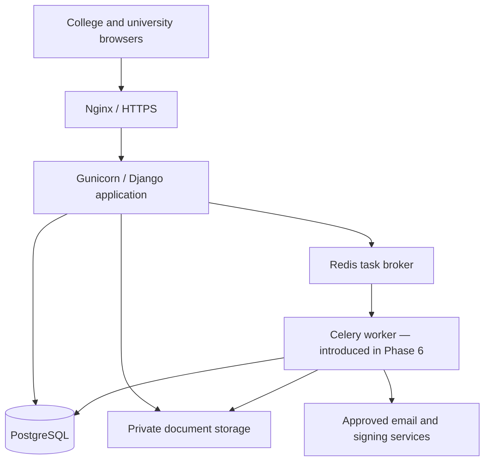

# Phase 0 — Foundation proposal

> Partially superseded on 9 September 2026. University-only Hindi intake, subject-expert scope and locked-final utilisation now govern. College portal, old counting boundary and associated workflow assumptions must not be implemented. See [current requirements](09-current-requirements.md). The original approval below is historical.

Status: **Approved as the Phase 1 discussion baseline by the user on 8 September 2026.** This approval does not approve a Phase 1 schema or application coding; see DEC-009.

## 1. Outcome and approval boundary

Agree the application architecture, role-based workspaces, module responsibilities, delivery method, and first demonstration contract.

Approval of this document authorises this foundation as the baseline and preparation of the Phase 1 account/college schema workshop. It does **not** approve database fields, account-assignment rules, the final authority matrix, nomination policy, or application implementation. Phase 1 needs its own concrete plan and approval before code is written.

This proposal deliberately keeps the open SRS questions in their dependent phases. It does not choose a six-person selection pool, a category-check interpretation, or cancellation counting semantics.

## 2. Product model

The college requests a panel for a Principal/HoD selection process. University staff scrutinise the request. An applicable approved panel and case-specific eligibility establish the candidates. The system recommends experts using approved fairness rules, checks representation, and records the approval. Issued letters, utilisation, reports, and audit history reflect approved decisions.

The system must explain who was recommended, why, who was skipped and why, who approved the result, and whether there was a recorded deviation.

Core distinctions to preserve in the later schema discussions:

- Expert identity versus membership in an approved panel.
- A source panel versus a proposed nomination and an issued nomination.
- General expert status versus availability/conflict for an individual selection process.
- A recommendation versus a final approval.
- Recorded nominations versus actual attendance; the SRS does not establish attendance tracking.
- Current master data versus the historical facts on which an approval depended.
- Annual utilisation versus lifetime nomination history.

## 3. Architecture

Use one modular Django application and one PostgreSQL database. Browser interactions use Django templates with HTMX enhancements and customised Bootstrap components. All permissions and business validations are enforced on the server.



This is the proposed deployment relationship, not provisioned infrastructure. Django and its worker share business services. PostgreSQL remains the source of truth; Redis is not the nomination ledger. Core approval must succeed independently of email delivery.

### Stack baseline

| Area | Baseline | Implementation treatment |
|---|---|---|
| Runtime and framework | Python 3.13; Django 5.2 LTS | Verify available supported patch versions and lock dependencies in Phase 1 |
| Database | PostgreSQL 17 | Use PostgreSQL in development and integration tests to exercise production constraints |
| Interface | Django templates, HTMX, Bootstrap 5.3 | Custom university interface; locally served, pinned assets |
| Letters | WeasyPrint | Controlled templates and escaped data; no arbitrary user HTML, CSS, or remote resource fetching |
| Background jobs | Celery and Redis | Introduce with document/notification work; durable delivery records and safe retries |
| Storage | Django storage interface | Private mounted storage initially; replaceable with institution-approved object storage |
| Deployment | Linux, Docker Compose, Nginx, Gunicorn | Environment-specific configuration; persistent database and document volumes |
| Testing | pytest, PostgreSQL, Playwright | Unit/business-rule, database integration, and browser journeys |

The web interface is server-rendered. Internal services carry business actions; a public REST API and a separately deployed frontend are outside the initial release. Storage, email, and signing use dedicated adapters so infrastructure choices do not change nomination rules.

Django 5.2 extended support ends in April 2028; PostgreSQL 17 support ends in November 2029. Record dependency versions and establish a maintenance/upgrade owner before the pilot. Sources: [Django support](https://www.djangoproject.com/download/), [PostgreSQL support](https://www.postgresql.org/support/versioning/), [HTMX documentation](https://htmx.org/docs/), [Django deployment checklist](https://docs.djangoproject.com/en/5.2/howto/deployment/checklist/).

### Proposed repository organisation

```text
config/                 Django settings, entrypoints, root routing
apps/
  accounts/             Accounts, role assignments, access policies
  institutions/         Colleges, affiliation and reference records
  applications/         College requests, scrutiny, deficiencies
  experts/              Expert identities and general status
  panels/               EC approvals and panel membership
  nominations/          Eligibility, ranking, drafts, nomination history
  approvals/            Approval actions, authority checks, deviations
  documents/            Private uploads, letter templates and versions
  notifications/        Delivery records and external channel adapters
  reporting/            Read-only dashboards, reports, exports
  audit/                Actor/action/change history
templates/              Shared layout and module screens
static/                 Local styles, scripts, and approved assets
tests/                  Cross-module, concurrency, browser tests
deploy/                 Container, proxy, backup and runbook assets
docs/                   Approved decisions and phase review material
```

This tree is a blueprint. Create executable modules only as their approved phase needs them. Within a module, separate models/constraints, business services, queries, forms/views, templates, and tests. Avoid a generic workflow engine or configurable rule language in the first release.

## 4. Workspaces and navigation

The shared layout provides university identity, current workspace, navigation, user menu, page title, and clear environment labelling on demo/staging. Do not invent an official seal or treat an unapproved visual identity as University branding.

| Workspace | Navigation and principal screens | Available by |
|---|---|---|
| College | Overview; My Applications; New Application; application detail/timeline; deficiency response; issued letters | Phases 1–2; letters in Phase 6 |
| Processing | Work Queue; scrutiny detail/checklist; deficiency history; verification | Phase 2 |
| Expert management | Experts; profile and status; institutions/subjects; import preview/errors | Phase 3 |
| Panel management | EC panels; membership; approval references; validity/status | Phase 3 |
| Nomination | Eligible cases; recommendation workbench; skips/conflicts; category checks; draft composition | Phase 4 |
| Approvals | Pending decisions; VC nominee review; deviations; approval history | Phase 5 |
| Letters | Preview; issued versions; signing and delivery status | Phase 6 |
| Reporting/audit | Utilisation dashboard; 15 reports; case audit; change/deviation history | Phase 7, with audit capture from Phase 1 |
| Administration | Accounts and access; reference data; controlled imports; operations | Incremental |

Only working, authorised features appear as active navigation. Future workspaces are documented in the roadmap, not displayed as functioning features.

UI principles: explicit labels, clear validation messages, visible statuses and next actions, keyboard accessibility, mobile-friendly college forms, desktop-friendly processing tables, pagination, and filtering. English labels are translation-ready; names and free text support Unicode. Colour alone must not communicate status.

## 5. Permission baseline for discussion

These are SRS-derived responsibilities, **not the final action-by-action permission matrix**.

| Role | Baseline responsibility | Boundary requiring preservation |
|---|---|---|
| College | Submit/view its own applications and respond to deficiencies | No other college's cases or unrestricted expert directory |
| Dealing Assistant | Scrutiny and data processing | No assumed power to issue final nominations |
| Section Officer | Verification | Final nomination authority is separately approved |
| Registrar | Administrative approval | Exact approval stages and delegation remain unresolved |
| Vice-Chancellor | VC nominee decision and authorised final approval | Alternative nominees must remain eligible; departures recorded |
| Administrator | Master-data/account maintenance within approved permissions | Technical/admin access does not imply business approval authority |
| Auditor | Read-only authorised reporting and audit | Cannot change business records or audit events |

The Executive Council approves source panels, but the SRS does not require a dedicated EC login. Experts are represented in master records; an expert self-service portal is not established by the SRS. Do not create either workflow without a later requirement.

Account provisioning, multi-role users, college membership changes, assignment scopes, and reset/MFA policy will be challenged in Phase 1. The nomination approval matrix belongs to Phase 5.

## 6. Integrity and operations baseline

- Treat status changes as explicit permitted actions rather than free-form editable fields.
- Capture actor, action, timestamp, relevant changes, and reasons from the first working workflow. Audit visibility is role-restricted; ordinary users cannot edit logs.
- Plan privileged audit protection and recovery controls; do not describe a database table as tamper-proof against infrastructure administrators.
- Keep approval, nomination history, and related utilisation/audit writes in one database transaction. Agree lock/revalidation scope in the allocation and approval workshops.
- Record approved historical facts so subsequent master-data edits do not silently rewrite issued decisions.
- Keep uploads private and serve downloads through authorisation checks. Agree formats, size limits, scanning, and retention before upload implementation.
- Use environment-based secrets and separate databases/storage for development, staging, and production. Never use real expert information in public sample data.
- Define retryable document/notification processing without duplicate approvals or letters. Delivery failures stay visible.
- Start automated checks and structured application logging in Phase 1; add release hardening throughout rather than postponing all security to Phase 7.
- Resolve expected workload, monitoring contacts, backup/recovery targets, retention, MFA, and institutional security review before live pilot use.

## 7. Review checklist and next gate

The user reviews whether:

1. The proposed modular architecture and deployment direction fit the intended ownership and maintenance model.
2. The workspaces and baseline role boundaries match how University staff should work.
3. The first-demo contract is the right stakeholder story.
4. The deferred decisions are placed early enough to prevent speculative schema or rule implementation.

After Phase 0 approval, prepare the Phase 1 workshop with a proposed account/college entity diagram, permission matrix, sample records, ownership rules, migration strategy, and test criteria. Resolve that workshop and obtain Phase 1 implementation approval before creating application code or migrations.
