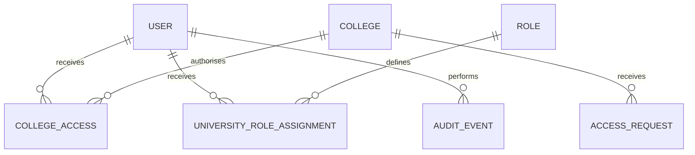

# Phase 1 — Account and college schema workshop

> Superseded after VC discussion: no college accounts, registrations or memberships. Do not implement this proposal. See [current requirements](09-current-requirements.md); a University-only phase plan must replace it.

Status: **Workshop record.** The discussion has advanced to the [consolidated Phase 1 approval package](08-phase-1-implementation-plan.md); that package is the current proposal, not yet approved. Phase 0 approved on 8 September 2026.

## What this phase must establish

People can sign in, reach the correct workspace, and access only permitted records. A college retains its identity and future cases when personnel change. Administrative actions remain attributable after accounts or assignments are deactivated.

Phase 1 will ultimately implement account/college records, approved role assignments, login/logout, role home screens, audit capture, synthetic data, reproducible setup, and automated access checks. It will not implement applications, expert panels, nomination rules, or final approvals.

## Proposed modelling method

Agree real-world ownership first, then relationships, constraints, example records, and tests. Avoid choosing fields simply because they are easy to put in one table. Record which facts change over time and which historical facts must remain explainable.

The first proposal separates the person signing in, the college they represent, and their permission to act for it:

This is conceptual, not a final database design. The user has confirmed **one active college assignment per person**, while historical assignments may be retained. Access requests are distinct from active accounts/assignments; their relationship to pre-activation identity and university staff requests is to be settled. System-originated audit events also need an explicit actor convention.

| Concept | Responsibility | Initial information to discuss |
|---|---|---|
| User | Identifies the individual who signs in | Stable ID, name, unique login identifier, credential/authentication status, activation and timestamps |
| College | Identifies the institution independently of its personnel | Stable ID, college code/name, district, college type, affiliation information and operational status |
| College access | Records a person's authorisation to represent a college | User, college, active/ended status, who granted/revoked access and when |
| University role assignment | Grants a defined university responsibility | User, role, assignment/revocation provenance and status |
| Access request | Records a request and University verification before access is granted | Applicant identity/contact, requested scope, review outcome, reviewer, timestamps, activation linkage; precise states and fields pending discussion |
| Audit event | Records relevant administrative/security actions | Actor, action, target identity, timestamp, approved before/after fields and reason |

University administrators maintain college identity and access under approved permissions. College users should not be able to activate their own affiliation or grant themselves university roles. The exact editing and delegation matrix is a discussion item.

A later application belongs to the college and records its human submitter separately. Replacing a staff member should not transfer institutional case ownership or rewrite earlier audit actors.

## Round 1 — Decisions requested now

| Topic | Recommendation | Alternative and consequence |
|---|---|---|
| College accounts | Multiple named staff accounts, with each action attributable to a person | One named operator per college simplifies initial access but requires a handover when they are unavailable or replaced |
| Provisioning | University creates accounts and assigns authorised access | User requests access followed by University verification; adds request, verification and activation states |
| College scope | One active college per person initially | Explicit multi-college assignments require a college switcher and scope checks on every action |

Round 1 is resolved: **multiple named staff accounts per college** (DEC-010); **users request access, University verifies and activates** (DEC-011); **one active college per person** (DEC-012). The provisioning alternative above was selected over the initial recommendation. Differences in permissions between college staff are not settled by the choice to allow multiple accounts. Shared credentials are not proposed because they prevent reliable attribution of actions to individuals.

The final schema must represent pending requests separately from granted access, prevent pending/rejected applicants from using protected workspaces, and enforce the single-active-college policy under concurrent approvals. Review/activation must retain who authorised the access. The exact request state machine, identity checks and activation mechanism remain proposals to discuss, not implemented policy.

## Round 2 — After account ownership is settled

Discuss:

1. Login identifier, activation, password reset, privileged MFA, and deactivation behaviour. Check whether University identity services already constrain the choice.
2. Single versus multiple university roles, technical administration versus business authority, and whether college access may coexist with a university role. Approve only the Phase 1 action matrix; final nomination powers remain in Phase 5.
3. Authoritative college codes/data, edit ownership, affiliation/status semantics, and changes when personnel or affiliation change.

Answers will produce a detailed schema proposal with field types, required values, keys, uniqueness rules, foreign keys, deletion/history policy, validation, role checks and migration implications. Do not create these structures before review.

## Cases to challenge the model

- College A has a manager and clerk: which may sign in and who can grant the other access?
- A person leaves College A: access ends while their earlier actions remain attributable. Who can see College A's old cases afterward?
- A person changes colleges: old College A URLs must not become accessible through their new assignment.
- A user also has a university role: does access combine, require a selected workspace, or need a policy restriction?
- An administrator creates an account: this alone must not grant Registrar or VC approval authority.
- An officer is deactivated during a session: subsequent protected actions must enforce the current access state.
- A college code/name changes: stable identity and future historical snapshots must prevent case ownership from changing accidentally.
- Two administrators grant access simultaneously: database constraints must enforce the approved active-assignment policy.

## Proposed Phase 1 acceptance evidence

- Reproducible project/database setup with supported, locked dependencies and synthetic accounts.
- Login/logout and role home screens; no credentials stored in source or displayed in audit logs.
- Correct access for approved roles, and rejection of unauthenticated, disabled, revoked and cross-college requests.
- Assignment changes and protected administrative updates produce attributable audit records.
- Database constraints enforce approved identity and assignment rules, including concurrent operations.
- Deactivation preserves history and stops subsequent protected access.
- Browser walkthrough and PostgreSQL-backed tests pass against the approved matrix.

These are proposed verification categories. Convert them into a final acceptance checklist after the account and college decisions are resolved.

## Final approval gate

Present one consolidated Phase 1 package: entity diagram, full schema, role/action matrix, worked examples, authentication method, migrations, setup/deployment approach, implementation sequence and acceptance tests. Obtain explicit approval of that package before coding Phase 1.

Current state: Phase 0 approved; all three Round 1 decisions confirmed. Requester eligibility, authentication, university roles, college-data ownership and detailed lifecycle controls remain under discussion. No final schema or Phase 1 implementation approval recorded.
