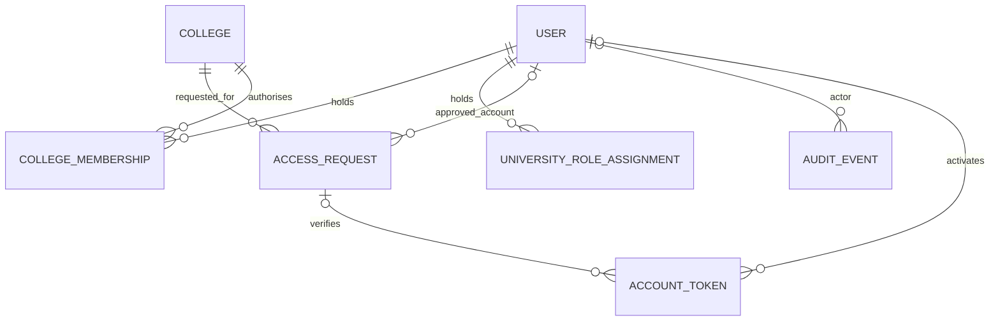

# Phase 1 — Schema and implementation approval package

> **Superseded; not awaiting approval and not authorised for implementation.** The user removed college access and registration after VC discussion. Refer to [current requirements](09-current-requirements.md) for University POC Hindi entry, allocation scope and final-lock utilisation. Preserve this document only as planning history.

Status: **Proposed for approval. No Phase 1 application code or migrations authorised yet.**

This package advances the workshop after the user's request to move forward. It incorporates DEC-010–012 and proposes explicit defaults for the unanswered questions. Approval of this package will authorise Phase 1 implementation only.

## 1. Decisions included in this approval

Already confirmed: multiple named staff accounts per college; University-verified access requests; one active college per person.

Proposed defaults:

1. College staff request access publicly. University officer accounts are invited internally by an Administrator; public applicants cannot request university roles.
2. Each person signs in using a unique verified email address. Store a normalised email and enforce case-insensitive uniqueness. Email changes are outside Phase 1 self-service.
3. University officers may hold multiple explicitly assigned university roles. College and university account types are separate in the initial release; no simultaneous college/university authority for the same person.
4. Administrators maintain college master data, verify college access requests, invite university staff, and manage assignments. Administrative access alone never grants nomination approval authority.
5. College staff have equal initial workspace access. No college staff member can create users, approve access, or edit affiliation/master data. Different submitter/manager powers can be discussed in Phase 2 before those actions exist.
6. College records are preloaded by University administrators. Public requests must identify an existing active college; they cannot create a college or assert affiliation.
7. Account approval requires a recorded verification reference and reviewer remarks. Verification is conducted by the University outside the application; Phase 1 records its outcome. Evidence uploads belong to the later approved private-document design.
8. Phase 1 is a local/access-controlled synthetic demonstration. Live email, public deployment, real personal data and pilot use require their later operating approvals. Privileged MFA remains a release requirement, scheduled before any live privileged use.

## 2. Data model

All business entities use UUID primary keys and timezone-aware timestamps. Store timestamps in UTC and display in Asia/Kolkata. Required strings are trimmed and cannot be empty. Foreign keys preserving identity/history use deletion protection. No business delete endpoints are provided.

### User — `accounts`

- Custom Django user from the first migration: `id`, `email` (254), `full_name` (200), `account_type` (`COLLEGE`/`UNIVERSITY`), `is_active` (false until activation), `email_verified_at` (nullable), `date_joined`, `updated_at`, and standard Django password/last-login/technical-admin fields.
- No public username or user-editable role field. Password hashing and validation use Django facilities. Invited users initially have an unusable password.
- University application permissions come from active role assignments, not a browser parameter or `is_staff`. Technical superuser access is a separate emergency/bootstrap capability; ordinary application actions still require their business role checks.
- A disabled user cannot access protected pages; the current user and assignment state is checked on each request.

### College — `institutions`

- `id`, `code` (50, unique case-insensitively), `name` (255), `district` (100), `college_type` (`GOVERNMENT`/`AIDED`/`OTHER`), `affiliation_status` (`UNVERIFIED`/`AFFILIATED`/`NOT_AFFILIATED`), `is_active`, `created_at`, `updated_at`.
- New records default to unverified. Only active affiliated colleges are offered for access requests. College status changes do not delete users or history.
- An inactive college blocks its workspace. Affiliation status is displayed as master data; post eligibility and submission rules remain Phase 2 policy.
- Code/name corrections retain the stable ID and audit the change. Future submitted applications will define historical snapshots in Phase 2.

### CollegeMembership — `accounts`

- `id`, `user_id`, `college_id`, `granted_by_id`, `granted_at`, `ended_at` (nullable), `ended_by_id` (nullable), `end_reason` (500, required when ended).
- An unended membership is the current assignment. A PostgreSQL conditional unique constraint permits at most one unended membership per user. The user must be a college account; both account type and the target college are checked in the assignment service.
- End time must not precede grant time. Ending an assignment retains its history. Transfers lock the user row, end the previous assignment with a reason, create the new one, and record audit events atomically.
- Membership alone does not permit login: the account must also be activated. Approval may reserve the assignment before activation.

### UniversityRoleAssignment — `accounts`

- `id`, `user_id`, `role` (fixed codes: `DEALING_ASSISTANT`, `SECTION_OFFICER`, `REGISTRAR`, `VICE_CHANCELLOR`, `ADMINISTRATOR`, `AUDITOR`), `granted_by_id`, `granted_at`, `ended_at`, `ended_by_id`, `end_reason`.
- At most one unended assignment per user/role. University users may hold several distinct roles. College accounts cannot receive university roles in Phase 1.
- Roles are fixed application choices, not user-authored permission bundles. Revocation takes effect on the next protected request. Future business actions will require explicit role checks in their approved phases.
- Administrators cannot change their own roles or disable their own account through the UI. Serialise administrator-assignment changes and prevent removing/deactivating the last active Administrator. Initial administrator creation uses a controlled local bootstrap command.

### AccessRequest — `accounts`

- `id`, `email` (254, normalised), `full_name` (200), `position` (100), `college_id`, `status`, `email_verified_at` (nullable), `verification_reference` (255, blank until approval), `review_notes` (1000), `reviewed_by_id` (nullable), `reviewed_at` (nullable), `approved_user_id` (nullable), `created_at`, `updated_at`.
- Statuses: `PENDING_EMAIL`, `PENDING_REVIEW`, `APPROVED`, `REJECTED`, `EXPIRED`, `CANCELLED`.
- Only one open request per normalised email across `PENDING_EMAIL` and `PENDING_REVIEW`. Existing-account emails receive the same generic public acknowledgement but do not create another identity or change an assignment.
- Approval/rejection requires a reviewer and timestamp. Approval additionally requires a verified email, active affiliated college, verification reference, review notes and linked account. Rejection requires a reason.
- Rejected or expired applicants may submit a new request; previous requests remain. No public lookup by email exposes request details. Transfers for existing users are administrator-reviewed actions, not anonymous re-registration.

### AccountToken — `accounts`

- `id`, `purpose` (`VERIFY_REQUEST`/`ACTIVATE_ACCOUNT`), `token_digest` (unique SHA-256 digest), nullable `request_id`, nullable `user_id`, `expires_at`, `consumed_at`, `revoked_at`, `created_at`.
- Exactly one target: verification targets a request; activation targets a user. Generate cryptographically random 32-byte secrets; store only the digest. Never include raw tokens in audit or normal request logs.
- Verification expires after 24 hours; activation after 48 hours. A valid resend revokes the previous unconsumed token. Consumption is transactional and one-time.
- Activation must revalidate current account authorisation and verified/invited state. Deactivation revokes outstanding activation tokens; no old token may reactivate a disabled account.
- Password recovery uses Django's password-reset flow with a one-hour token timeout, generic responses and password validation. It does not activate inactive accounts.

### AuditEvent — `audit`

- `id`, nullable `actor_id`, `actor_kind` (`USER`/`SYSTEM`/`ANONYMOUS`), `action` (100), `target_type` (100), `target_id` (UUID), `occurred_at`, `changes` (JSON with allowlisted before/after values), `reason` (1000), `correlation_id` (UUID).
- Actor identity remains protected from deletion. Anonymous submission/verification and bootstrap/system actions explicitly identify actor kind. Do not record passwords, tokens, session cookies, full request bodies or uploaded content.
- Capture college edits, access decisions, membership/role grants and revocations, activation/deactivation, login/logout and failed authentication in appropriately sanitised events. Unknown-login failures must not create a user or record raw submitted identifiers.
- Business changes and their audit writes share a transaction. Read-only audit screens; no application update/delete service for events. This is not a claim of tamper-proof storage against database administrators.

## 3. Registration and activation journey

1. Applicant selects a known college and supplies individual name, email and position. The public response does not disclose whether the email already exists.
2. A verification link is delivered to the applicant's email. A pending request grants no account or college access. An expired request can be resubmitted; a valid verification changes it to `PENDING_REVIEW`.
3. An Administrator reviews verified requests and records the University verification reference and remarks. Applicants cannot review themselves or choose their own permissions.
4. Approval locks the request and writes the inactive account, current college membership, approved-request link and audit event atomically. Duplicate reviews do not create duplicate records. Conflicting identity/membership constraints produce a clear review error without partial writes.
5. Send activation after the transaction commits. Activation sets a validated password and enables the account, provided its authorisation is still valid. Approval and activation have separate audit events.
6. A rejected request retains its reason for university review. A notification tells the applicant the outcome without exposing other applicants or internal sensitive details.

University invitations follow the same verified activation link/password setup, with Administrator-selected university role assignments instead of a public college request.

In Phase 1 emails go to a local-only mail capture service (Mailpit). No live messages are sent. Show mail failure and allow safe administrator retry without repeating approval. Real delivery tracking and background jobs are Phase 6; activation functionality introduces the email adapter now.

## 4. Screens and access matrix

| Actor | Phase 1 actions |
|---|---|
| Public visitor | Request college access, verify link, activate invitation, sign in, request password recovery |
| Active college staff | College home/profile read; own identity; logout; no access to other colleges or account administration |
| University staff | Home and navigation for their active roles; no later-phase approval/workflow actions yet |
| Administrator | Maintain colleges, review access requests, invite staff, manage other users/assignments, revoke access, read account-administration audit |
| Auditor | Read-only administrative audit; no user/college/assignment mutations |
| Disabled/revoked user | No protected workspace; identity history remains |

Role screens may show an honest empty state describing their current phase. Do not display invented utilisation statistics or functioning links to unimplemented modules.

Mutations use POST with CSRF validation. Foreign or forbidden object IDs never expose protected contents. Authorisation is enforced on reads and writes, not merely by hiding navigation. Rate-limit login by both network source and normalised identifier; use 5 failed attempts per identifier per 15 minutes and 30 per IP per 15 minutes as configurable demo defaults. Limit request/reset/resend endpoints to 5 per identifier per hour and 30 per IP per hour; store throttle keys as keyed hashes in the database cache, with generic messages. Do not trust forwarded client-IP headers except from a configured proxy.

## 5. Build and migration sequence

1. Establish Git/project configuration, Python 3.13 container, PostgreSQL 17 service, environment example, Django settings and test tooling. Pin supported available patches; do not embed credentials. Use PostgreSQL for integration tests.
2. Create the custom user in the first accounts migration, college records in institutions, then account requests/assignments/tokens and audit records in dependency order. Add constraints and fixed role choices; no real data migration is required in this empty project.
3. Implement transactional services, server-side access policies, registration/review/activation and administrative actions.
4. Build the responsive shared layout, login and request pages, review screens, role home screens and read-only audit view. Serve pinned interface assets locally.
5. Add Mailpit for local captured authentication email and a repeatable synthetic-data command. Keep bootstrap credentials out of source; seed only an explicitly marked non-production database.
6. Run model/constraint, transaction and browser tests; document start/stop, migrations, seed, mail capture and test commands. Present the Phase 1 demo and evidence.

Environment inspection found Docker/Compose installed, but the Docker engine could not be reached; system Python is 3.11. The chosen execution path remains the Python 3.13 Linux container. At implementation, check/start the permitted Docker environment and request any necessary host permission. Do not silently downgrade Python or substitute SQLite to claim validation passed.

No public staging or production deployment is authorised by Phase 1 approval. New migrations are versioned and tested from an empty database; preserve existing data if development is resumed against a nonempty database. Do not reset it automatically.

## 6. Acceptance and concrete examples

| Test | Required result |
|---|---|
| Two staff at College A | Both approved named users access A; audit records distinguish them |
| College B user/direct URLs | Cannot read or change A's protected records |
| Pending/rejected request | Cannot sign in or gain membership through forged public fields |
| Email normalisation | Case variations cannot create duplicate identities/open requests |
| Two reviewers approve at once | One account, one assignment, one decision; no partial audit/business state |
| One person requests two colleges | No second current assignment; no anonymous transfer |
| Transfer A to B | Previous assignment retained; A access stops; B access is explicit and audited |
| Role combinations | Allowed university roles combine; college/university mixing and duplicate role grants are rejected |
| Admin versus approver | Account administration never exposes unimplemented nomination approval authority |
| Last admin/self-change | Ordinary UI cannot lock out all administrators or self-elevate |
| Activation/reset | Expired, consumed, revoked and tampered tokens fail; reset cannot activate disabled users |
| Deactivation during session | Next protected request denied; historical actors and events preserved |
| Failed email/retry | Approval stays committed once; resend works without duplicate grants |
| Audit privacy | No secrets or token-bearing URLs appear in normal logs/audit; UI cannot edit events |
| Interface | Keyboard-operable forms, clear field errors, mobile layout and role-appropriate navigation |
| Setup | Empty PostgreSQL database migrates; synthetic demo and browser journey reproduce from documented commands |

The added request/verification/activation flow expands the original foundation slice. Allow approximately **4–5 working days for Phase 1**, subject to environment readiness and approved scope; retain the week-two application demo as a target and review feasibility at Phase 1 completion. Do not shorten testing or bypass Phase 2 approval to meet the date.

## 7. Approval scope

Approval means implement this Phase 1 schema, policies, local demo and tests, including the proposed defaults in section 1. It does not settle expert-panel, allocation, category, nomination-count, final-authority or official-letter rules. Those retain their scheduled gates.

Technical references consulted: [Django custom user and initial migration](https://docs.djangoproject.com/en/5.2/topics/auth/customizing/), [database constraints](https://docs.djangoproject.com/en/5.2/ref/models/constraints/), [Django authentication and password recovery](https://docs.djangoproject.com/en/5.2/topics/auth/default/).
