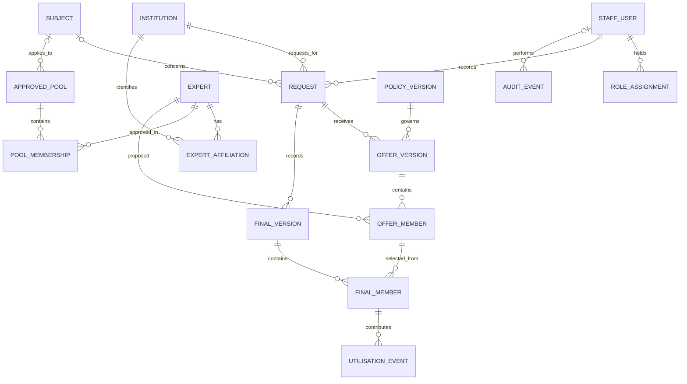

# University foundation — schema workshop and revised delivery sequence

Prepared 9 September 2026. **Section 10 first-slice package approved on 12 September 2026 (LGTM, DEC-029) and implemented.** See [handover](12-foundation-implementation.md). Future expert/allocation relationships remain conceptual; the workshop text below preserves the reviewed proposal. This replaces documents 07–08 as the active workshop. The [current requirements](09-current-requirements.md) remain authoritative. The user authorised preparing this proposal after confirming a common utilisation count (DEC-027).

## 1. Outcome and approval boundary

The next working demonstration should let named University staff sign in, maintain institution/subject records and save/reopen Hindi request drafts. It should establish the data on which expert eligibility and allocation will depend.

This proposal covers that first persistent foundation in detail and shows the later allocation relationships conceptually. It does not ask for approval of unseen allocation, final-selection or signing rules. The user has confirmed administrator-created named accounts, a shared queue for authorised processing staff, and exactly one current college per expert. Other explicit proposals below must be included in the consolidated approval package; silence is not approval.

Existing preview pages are working presentation only. There are no domain models or saved cases to migrate. Homepage wording remains deferred.

## 2. Proposed overall relationships

The diagram shows proposed boundaries, not a complete physical schema. Pool applicability, affiliation multiplicity and final membership constraints require their workshops. Audit events also identify the affected record; a nullable staff actor is allowed only for an explicitly identified system action.

The important distinction is between the approved source pool, an offered list, management's recorded choices and a locked final version. Keeping them separate prevents an offer from accidentally increasing utilisation.

## 3. First persistent slice — proposed records

All proposed business IDs are UUIDs. Dates with times are timezone-aware, stored in UTC and displayed in Asia/Kolkata. Human names support Unicode; no English duplicate is required. Stable identities, rather than spelling comparisons, link records. Required text must contain non-whitespace characters.

### Staff user and role assignment

Proposed custom Django user from the first accounts migration:

| Field | Proposed definition |
|---|---|
| id | UUID primary key |
| username | Required unique login identifier, up to 150 characters; case-insensitive uniqueness |
| full_name | Required Unicode text, up to 200 characters |
| email | Optional contact address, up to 254 characters; not the initial identity key |
| is_active | Whether sign-in and protected actions are permitted |
| password, last_login | Django-managed password hash and sign-in information |
| created_at, updated_at | Timestamps |

**Authentication proposal:** username/password for the local demonstration, avoiding a dependency on live email. Use Django password validation and session handling; no shared staff login. University SSO requirements, activation/reset delivery and privileged MFA must be resolved before live use. This is a proposed choice, not a confirmed institutional authentication method.

Role assignment: ID, user, role code, granted by/at, revoked by/at and reason. Preserve ended assignments. Enforce one active assignment per user/role. Proposed support for multiple roles allows an officer to hold explicitly granted duties; technical administration does not confer business approval powers.

Confirmed: an administrator creates named University staff accounts. No public or staff self-registration flow. Proposed local-demo setup: administrators create an inactive account with an unusable password; a local privileged setup command enables it after setting a validated password through a hidden prompt. Never store or print credentials in seed files or audit. Live activation/reset delivery requires its later reviewed mechanism.

### Institution

Use one institution identity for requesting colleges and experts' home institutions, including external institutions. Separate college and university name tables would risk failing the own-college check through duplicate identities.

| Field | Proposed definition |
|---|---|
| id | UUID primary key; stays stable when a name changes |
| name | Required Unicode display name, up to 255 characters |
| official_code | Nullable authoritative code, up to 50 characters; scoped uniqueness needs the data source |
| district, address | Optional Unicode directory information at draft stage |
| institution_kind | Controlled classification; full vocabulary to be checked against real master data |
| management_type | Government/aided/other classification where applicable; unknown remains explicit |
| affiliation_details | Removed by the user after foundation implementation (DEC-030); no longer collected or stored in the college directory. |
| is_requesting_college | Superseded by DEC-047. Institution type now determines whether it can be selected for a request; request status is stored on the request itself. |
| is_active | Directory status, distinct from EC approval and case eligibility |
| created_by, updated_by, timestamps | Maintenance provenance |

Institution identity/code ownership is Q-03. Proposed maintenance owner: authorised master-data staff. Do not let POC free text silently create a verified institution. A missing college goes through directory maintenance. Do not automatically merge equal-looking Hindi or English names, or use a name as a primary key.

A UUID can identify records while official-code conventions are unresolved; an entered code must not be presented as verified until its source is established. No arbitrary global official-code uniqueness assumption is approved.

### Subject

ID, required Unicode name (200), optional authoritative code (50), active flag and maintenance provenance. Requests select a subject identity rather than create a new spelling each time. Duplicate review and code scope belong to master-data approval; name similarity alone is not a merge rule.

### Request draft

| Field group | Proposed definition |
|---|---|
| Identity | UUID, requesting institution, creator and timestamps |
| Scope | Appointment type: Principal, HoD or subject expert; optional subject while drafting |
| Request details | Vacancy description, sanctioned-post details, advertisement reference, proposed selection date, nullable nonnegative candidate count, remarks |
| College contact | POC-entered principal/manager details supplied with this request |
| Provenance | Last editor and timestamp, integer revision for detecting competing edits |
| State | Draft only in this slice; later states require the scrutiny workshop |

**Proposed minimum to save a draft:** requesting college and appointment type. Other intake fields may remain incomplete. This is not permission to submit or allocate an incomplete application. Required submission evidence and per-post subject rules remain Q-04/Q-05.

College directory details are displayed from the linked identity. Preserve request-specific contact details separately. At a later reviewed submission/offer event, snapshot the institutional and request facts needed for historical decisions; do not silently pick the snapshot event now.

No official reference-number scheme is inferred from a draft UUID. Private uploads will be added with their validated storage/access rules in the request workflow slice.

### Audit event

ID, actor (staff or identified system), action code, target type/ID, timestamp, request/correlation ID, permitted before/after values and reason where required. Never record passwords, session tokens or secret-bearing links. Audited changes and their events commit in the same database transaction. A failed audit write must not leave a successful unrecorded business mutation.

Normal screens cannot edit or delete audit events. This is application-level protection; production database privileges, retention and tamper monitoring remain part of operational readiness. Do not claim that an ordinary audit table is tamper-proof.

## 4. Proposed first-slice permissions

| Capability | Account administrator | Master-data maintainer | Processing staff | Read-only reviewer |
|---|---|---|---|---|
| Manage staff access | Yes | No | No | No |
| Maintain institutions/subjects | Only with master-data role | Yes | No | No |
| View permitted directory records | Yes | Yes | Yes | Yes |
| Create/edit request drafts | Only with processing role | Only with processing role | Yes, within agreed case scope | No |
| Read request drafts | Only with relevant business role | Only with relevant business role | Within agreed scope | Within agreed scope |
| Review relevant audit | Account administration events | Directory changes | Permitted case history | Explicitly granted audit scope |
| Issue offers, approve deviations, lock finals | Not implemented in this slice | Not implemented | Not implemented | Not implemented |

These are capability proposals, not presumed VC/Registrar titles or grants. Confirmed: all authorised processing staff can view and edit all college request drafts through a shared queue; no per-case access assignment is required initially. An administrator cannot grant themselves business authority through the ordinary interface; bootstrap and role-grant authority must be explicit in the consolidated package.

## 5. Later records — preserve the right boundaries now

| Record | Responsibility and later gate |
|---|---|
| Expert | One person with identity/contact/category facts; no directly editable utilisation field. Exact SRS field mapping and classification validation at expert workshop. |
| Expert affiliation | Links person to institution with effective dates and designation/history. Exactly one current college per expert is confirmed. Preserve past affiliations with dates; reject simultaneous current college affiliations. The eligibility reference date and treatment of external experts' university affiliations still need the expert workshop. |
| Approved pool / membership | Approval reference, applicability, validity, approved expert/role and fixed sequence. A pool can contain more than six people. Sequence scope, EC evidence and validity constraints need approval. |
| Policy version | Independent appointment-type composition and rule version; provisional subject-expert status preserved. No unrestricted rule editor. |
| Offer version / member | Exact proposed panel, policy/evidence snapshot, recommendation and skip reasons. Repeat generation creates traceable versions. No utilisation effect. |
| Final version / member | POC-recorded management choices, later authorised lock, selected offer membership and historical facts. Final subset/category/authority rules still open. |
| Utilisation event | Traceable locked selection contribution or reversal linked to the original event. One common count per expert/year; no manual counter editing. Cross-year corrections need their policy workshop. |
| Replacement | Links removed and replacement memberships, reason and authorisation; recommendations pass through the same engine. Exact draft/lock transitions remain to be approved. |

Proposed totals are derived from the event history initially. If performance later requires stored summaries, reconcile them to that history and update atomically. A shared annual total does not erase role-specific report detail. No extra ranking score is introduced for outstanding offers.

On final lock, approval state, membership, utilisation contributions and audit must commit together. Repeated requests must have a unique operation identity, and concurrent changes must be revalidated. Later implementation will choose and test locking order across affected experts; merely using a transaction is not sufficient proof of concurrency safety.

## 6. Examples to challenge the proposal

All examples are synthetic.

| Situation | Expected result / discussion point |
|---|---|
| POC enters “आदर्श महाविद्यालय” with an incomplete advertisement reference | Save/reopen a draft under the proposed draft minimum; cannot call it verified or ready for allocation. |
| Two staff edit revision 4 | First save creates revision 5; second receives a conflict and can review changes rather than overwrite silently. |
| A college changes its name | Identity stays stable; later historical offer/letter snapshots preserve the name actually used. |
| Expert E belongs to requesting College A | E is excluded regardless of spelling, role, count or pool shortage. A second current college affiliation must be rejected; keep previous affiliations as history when a verified change occurs. |
| E has one locked subject-expert duty and one locked VC duty in the same year | Common utilisation is 2. Three additional pending offers leave it at 2. |
| E has a pending offer and otherwise outranks F by SRS keys | Pending status alone does not move E below F. |
| Operator changes lecturer composition later | New authorised policy version affects that appointment type; issued history is retained. |
| Account is disabled after making requests | Subsequent protected access stops; creator and audit identities remain. |
| Institution/master record is referenced by a case | Do not delete it through ordinary maintenance; archive or correct with provenance. |
| Final subset omits a category included in the offer | Remains a later decision; the foundation does not fabricate a valid final committee. |

## 7. Implementation sequence after approval

1. Finalise the first-slice field dictionary and permissions with the answers to this workshop. Resolve username/provisioning, directory classification/code source and draft minimum explicitly in the approval package.
2. Establish an isolated PostgreSQL development database; do not use or reset an unidentified existing database. Verify access and engine availability. Preserve the current preview until the persistent mode is ready.
3. Add custom user in its initial migration, institutions/subjects, role assignments, draft requests and audit in dependency order. No destructive reset; check actual database state before migrations.
4. Implement authentication, role checks, directory maintenance and Hindi draft create/edit/reopen with audit and edit-conflict handling.
5. Verify PostgreSQL constraints/transactions and browser journeys; demonstrate with synthetic accounts/data. Update traceability with actual evidence.

Proposed verification: denied unauthenticated/disabled/unauthorised direct access; approved shared or assigned scope; duplicate role constraints; Hindi round-trip; incomplete draft versus unimplemented submission distinction; stale-edit rejection; protected deletion; audit rollback; empty-database migration. No production or allocation correctness claim follows from these tests.

## 8. Revised demonstration sequence

Estimates are working-day allowances starting after each scope approval, not fixed delivery promises. External services and unresolved policy can extend them.

| Slice | Allowance | Stakeholder demonstration |
|---|---|---|
| Foundation completion | 3–5 days | Named staff login, directory maintenance, saved Hindi drafts and attributable history |
| Experts and approved pools | 4–5 days | Expert/institution/subject records, EC-approved pools, eligibility inspection and import preview |
| Allocation workbench | 5–8 days | Explainable six-name offers plus VC/category roles; common-count ranking, own-college exclusions and pending eligibility |
| Request scrutiny and offered-panel workflow | 3–5 days | Required evidence, scrutiny/correction and reviewed offers, using approved transitions |
| Final choices and replacements | 4–6 days | Management choices captured, authorised lock, correct common counts and traceable replacements |
| Letters and communications | 4–5 days | Approved Hindi sample-based format, versioned PDFs and controlled delivery |
| Reports and readiness | 7–10 days | All 15 reports, permissions, reconciliation, security, backup restore and operating evidence |
| Controlled pilot | About 5 days | Supervised staff use, acceptance findings and rollout decision |

Aim for a saved-request demonstration first and an allocation demonstration next, with weekly showings of completed work. The engine can be demonstrated with clearly labelled synthetic eligible requests before the full scrutiny workflow is complete; operational offer issue stays blocked until that workflow and authority are approved. This reordering is proposed, replacing the old college-submission-first milestone; it does not remove any SRS reports or readiness requirements.

## 9. Decision gate

Resolved round: administrator-created named accounts, shared processing queue and exactly one current college per expert. The remaining first-slice proposals are login method, roles/grant authority, directory fields and draft minimum; these require explicit approval as a consolidated implementation package. Expert-pool, ranking tie and final-lock questions remain at their dependent workshops.

Approval of the final first-slice package will authorise its models, screens, migrations and verification only. No implementation starts from this workshop draft merely because an unanswered option was recommended.

## 10. Consolidated first-slice proposal following the answers

Confirmed choices above are recorded in DEC-028. For approval, the proposed implementation boundary is:

- Local demonstration username/password login and administrator-created named accounts; no self-registration or live email dependency. Account disabling preserves history.
- Multiple explicitly granted roles, using the section 4 matrix. Initial bootstrap performed locally by the designated administrator; ordinary role management can grant other staff foundation roles, cannot self-elevate and cannot remove the last active account administrator. No nomination approval or final-lock permission exists yet.
- Shared queue for processing staff. Read-only reviewers can see all draft cases only when explicitly assigned that role. Account administration alone grants no case access.
- Institution and subject directories as proposed. Until an authoritative coding scheme is supplied, official codes are optional informational values, with UUIDs providing uniqueness; do not claim code verification or enforce invented code scopes. First-slice institution kinds are college, university and other; management classification is government, aided, other or unknown. These directory labels alone never establish allocation eligibility.
- Only institution records explicitly marked as requesting colleges can be selected for drafts. Inactive entries cannot be selected for new drafts; old references and history remain visible to authorised staff. Selecting an institution is not proof that the request passed affiliation scrutiny.
- Saved Hindi drafts require a requesting college and appointment type. Remaining SRS request fields may be incomplete while drafting. Drafts have edit-conflict detection and an attributable change history; submission, uploads, allocation and final lock remain later slices.
- PostgreSQL-backed migration and access/integrity verification, followed by the saved-request demonstration. No changes to homepage slogans.

The one-current-college rule guides the expert schema; no expert affiliation migration is included in this first-slice approval. Confirm exact external-institution and effective-date representation at the expert workshop. The user accepted this first-slice package on 12 September 2026. That approval covers the foundation implementation and verification; it does not approve the later expert or allocation schemas.
