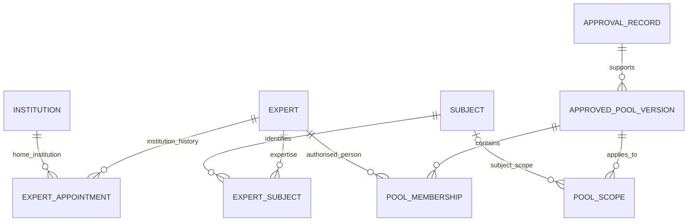

# Experts and approved candidate pools — next-phase workshop

12 September 2026. **Approved and implemented after the user's full workshop LGTM.** The Principal/Professor clarification and inline staff checks are part of the approved scope. See [implementation handover](15-expert-pool-implementation.md). Proposal/approval-request wording below preserves the reviewed package's history; it does not mean approval is still pending. The original roadmap called this domain Phase 3.

Sources: original SRS sections 4–7, 10–16, 24–26 and 30, read again with the rest of its text and the master-table/visual-summary pages; [current requirements and user overrides](09-current-requirements.md). The user has asked staff to collect college/subject information while we proceed. Removing college affiliation details does not remove the institution link needed to exclude an expert's own college.

## Demonstration contract

An authorised officer can create an expert, link the expert to an institution and subject, record the applicable approval/list membership, and inspect why a record is ready or incomplete. Staff can inspect approved lists by role, appointment type and subject without duplicating a person's identity.

This phase establishes records and approval provenance. It does not generate or issue a six-name offer, implement fairness ranking, record management's final choices, change utilisation, sign letters or declare a production release. Eligibility inspection must identify outstanding checks; it must not label a record fully eligible while date/conflict or approval facts are missing.

## Confirmed boundaries

- One identity per expert. Common utilisation across roles and appointment types is confirmed for later accounting; no counters are hand-entered on this master screen.
- Each expert has exactly one current college. Keep past institution links as history; no simultaneous current college assignments.
- The SRS expressly allows a college or university as the expert's institution and permits external VC nominees. Represent an external university through the existing institution directory. The proposed single-home-institution model below extends the same identity relationship to those external experts; verify that representation in the package before implementation.
- Own-college exclusion is unconditional, across main, VC and supplemental roles and replacements. Match institution identities, not names or spelling.
- Principal, Professor and permitted Assistant Professor supplemental roles must be representable. Do not infer Professor rank merely because someone is designated Principal.
- Full approved candidate pool supplies the offered six. Source records are not constrained to exactly six names.
- Keep SC and ST distinct as recorded categories; group them only for the SRS SC/ST representation check. Unknown category is incomplete data, never silently General.
- Pending offers do not alter eligibility/ranking by themselves. Ranking stays common annual count, oldest nomination date, fixed sequence.
- English and Hindi text are both supported. Automatic conversion has not been authorised or built; preserve supplied spelling. A later reviewed Hindi version must not overwrite the source name or create a second person identity.

## Proposed relationships

All names above are proposed entities. Existing staff, institution, subject and audit records are reused. The user confirmed multiple separately approved subject/list memberships and one permanent sequence per expert (DEC-031).

The expert record answers **who this person is**. Institution history answers **where they belong**. Membership answers **which approved list permits their use for this duty**. None of these is the same thing as a nomination.

## Proposed expert field dictionary

| Field / relation | Proposed definition and validation |
|---|---|
| Expert ID | Generated UUID; immutable identity. Never use name, mobile or email as the primary key. |
| Name | Required Unicode full name, 200 characters; keep the spelling supplied. No forced English/Hindi pair in this slice. |
| Category | General/OBC/SC/ST; may be incomplete during entry but must be known before category-dependent readiness. No default category. |
| Mobile | Text, up to 32 characters; preserve country codes and leading zeroes; validate format without assuming every expert has an Indian number. Proposed optional while entering records. |
| Email | Validated email field, 254 characters, proposed optional while entering records. Shared/missing contact details must not merge people automatically. |
| Active state | Active/inactive plus reason/provenance. Deactivation retains identity, memberships and history. Active does not mean available for every case. |
| Sequence | Confirmed: one permanent expert-level sequence, reused across all memberships. Proposed generation method is in the consolidated package below. No auto-reordering by name or utilisation. |
| Institution/designation | Separate dated appointment record, described below. |
| Subjects | Approved links to existing subject identities; multiple subjects are permitted where separately approved. |
| Nomination totals and last date | Later history-derived read-only information. Display “history not loaded” rather than fabricated zero utilisation when no opening-history decision exists. |
| Revision / provenance | Revision number, creator/editor, timestamps; reuse audited saves and stale-edit rejection. |

Proposed incomplete entry needs a name only and is clearly marked incomplete; it cannot become a usable candidate simply because it was saved. Proposed ready-record minimum: resolved home institution, designation/rank facts needed for the intended duty, category, required subject scope, active status, approval membership and approved sequence. Contact requirements for delivery remain a later gate; optional entry does not mean optional official communication.

Do not create a loosely editable `vc_eligible` checkbox that can bypass SRS conditions. The displayed VC eligibility should be derived from verified rank, internal/external institutional facts and applicable approval. Store the evidence and verified classification, not only an unexplained true/false result.

## Institution and designation history

Proposed appointment record: expert, institution, designation, separately verified academic rank where necessary, start/end dates, recorded-current flag, provenance and change reason. Use one current home institution for a complete expert, with history retained when it changes. This covers College A → College B without creating a second expert or resetting counts.

Partial drafts may have no institution yet; they remain unusable. Enforce at most one recorded-current home link in the database, and exactly one when a record is marked ready. Current-link replacement must be transactional. Unknown historical start dates stay explicitly unknown; do not invent a date to satisfy a constraint. Reject known reversed/overlapping appointment periods under the final agreed date semantics.

The SRS distinguishes Government/Aided/University/External and VBSPU affiliation. The existing institution table already separates institution kind and management type. **Proposal:** record a verified internal/external classification on the expert's appointment, with evidence/reference and verifier, rather than restoring the removed free-text college-affiliation-details field. A request-enabled college flag is not sufficient evidence for VC eligibility.

For a Principal, preserve the designation and the verified substantive academic rank separately if needed for Professor/VC eligibility. If rank equivalence is not established, show “verification needed”; do not silently classify every Principal as Professor. Additional rank vocabulary such as Associate Professor needs review against actual records; the SRS does not define a full rank hierarchy.

Retirement, transfer, leave and case conflicts are not interchangeable. This phase can record master deactivation and institution changes; final date-specific availability and case-conflict records belong to the allocation workflow. Do not implement retirement or transfer as an irreversible automatic exclusion without their agreed policy.

## Approval and pool records

| Record | Proposed data |
|---|---|
| Approval record | UUID, approval authority/type, reference number, approval date, source description, recorded-by/time and verification provenance. Reference need not be globally unique: one resolution may cover multiple lists. |
| Pool version | Stable list identity plus version, title, nomination role (Principal/Professor/SC-ST supplement/OBC supplement/VC nominee), approval record, effective date, nullable prescribed end date, lifecycle state and supersession link. |
| Pool scope | Explicit appointment type and subject applicability. A deliberate all-subject scope is distinct from a missing subject; it requires university approval rather than being inferred from a blank cell. |
| Pool membership | Pool version, expert, applicable approval provenance, validity bounds if individually prescribed, withdrawal state/reason, with no separate allocation sequence at membership level. |

The SRS supplies EC approval and validity metadata and names a VC-nominee panel type, but does not fully define the source authority for every VC candidate list. Record the actual authority/reference; do not silently require or invent an EC resolution for a VC list whose authorised source is different. That source must be confirmed before implementing the VC-list activation rule.

Proposed lifecycle: editable entry → verified record of existing approval → available within its prescribed date range → expired/superseded as applicable. Making a list available records an existing University decision; software users do not themselves grant EC approval. The user confirmed that existing directory-maintenance staff may record the approval and make the list available (DEC-031).

Published versions should not be overwritten. Corrections/supersession retain the previous version and require reason/evidence. Proposed constraints: unique version per list; one expert occurrence per pool version; valid date bounds; protected expert/approval/institution references. Membership validity cannot enlarge the pool's approved validity. Nullable end date means no end date was prescribed only when explicitly verified; it must not mask incomplete data.

If several active versions/scopes match a request, the app must expose that ambiguity. Do not choose the newest, union them or silently prefer one without a decided precedence rule. This is a discussion gate before automatic allocation, not a reason to corrupt the approval records.

## Maintenance permissions — proposal

- Existing directory-maintenance role may enter and correct expert master facts and draft approval lists. Approval verification/activation follows the answer to the current authority question.
- Processing staff can inspect expert/list eligibility facts needed for work. Personal mobile/email access should be explicitly approved in the final role matrix; do not automatically expose those fields to every directory viewer.
- Read-only reviewers can inspect approved scope/history under the granted review role; personal contact access is separately controlled.
- Account administrators receive no expert/business powers solely from account administration.
- No processing screen can casually edit sequence order. First assignment and later exceptional correction need explicit permission, evidence, reason and immutable history, consistent with SRS section 30. Sequence source and approval for changes must be included in the final package.

## Import preparation

Produce the expert collection template after the field dictionary is approved. Proposed sheets/record groups are Experts, Institution History, Approved Lists and List Memberships; the number may be reduced for staff entry if a clear master-to-membership relationship is retained. Do not flatten multiple memberships into duplicate experts.

Import should preview rows, unresolved institution/subject matches, duplicates, missing values and contradictory approvals before writing. No match by fuzzy name alone; require explicit identity resolution. Preserve source values and row references in the eventual controlled import record. Hindi translation/transliteration is separate from identity matching.

This phase proposes import **validation preview**, followed by a separately reviewable commit design. Existing college/subject collections can continue in parallel. Opening nomination history needs Q-17 and the ledger design before import can claim accurate annual or lifetime counts. Do not request editable current-count columns as a shortcut.

## Worked examples / acceptance evidence

| Scenario | Required result |
|---|---|
| Same expert on Professor and VC lists | One identity and later common usage history; separate approved memberships if the user confirms multi-list support. |
| Two people have identical names | Separate identities; possible duplicate flagged for review, never merged automatically. |
| College name appears in Hindi and English | Explicit mapping to one institution identity; spelling does not defeat own-college exclusion. |
| College A expert is considered for A | Own-college rejection, including VC/category duties and small pools. |
| Expert moves from A to B | Preserve A history; exactly one current institution. Which effective date governs a specific request remains a reviewed rule. |
| Assistant Professor in approved SC/ST list | Supported supplemental record; not silently promoted into main Professor or VC roles. |
| Principal's Professor rank is undocumented | Needs verification for Professor/VC use; title alone does not answer the rank question. |
| Approval expires before a relevant date | Show expiry and its evidence; final selection/offer date boundary must be approved before enforcement for real nominations. |
| No prescribed end date versus missing end-date information | Distinct verification state; no invented perpetual validity. |
| Pending offer elsewhere | No extra utilisation and no automatic exclusion/demotion. |
| Historical nominations not yet supplied | Show unknown/unloaded accounting, not an asserted zero. |
| Approval superseded or master corrected | Earlier versions and audit survive; no historical offer rewriting. |

Future verification will cover PostgreSQL constraints/transactions, reference protection, concurrent current-institution updates, access to personal contact fields, sequence-change restrictions, Hindi/English round-trip, invalid date/scope combinations and import-preview rejection. These are acceptance obligations, not implemented tests.

## Remaining decisions and implementation gate

Current questions:

1. Q-08: one permanent sequence per expert versus a position within each approved list.
2. Q-07: multiple approved subjects/list memberships for one expert.
3. Q-15 (pool-record subset): existing maintainer records approval versus a separate verifier before list availability.

After those answers, consolidate: single-home-institution representation for external experts, rank evidence/vocabulary, internal/external verification, VC list source, pool/date scope, proposed entry/ready minimum and contact permissions. Keep these as explicit proposed choices rather than unspoken implementation defaults.

Then present the final schema, constraints, authority matrix, source-to-field mapping, migrations and demo checklist for approval. No expert/pool model migration is authorised by the request to continue this workshop. The first-slice database and running application remain unchanged while this proposal is reviewed.

## Consolidated implementation proposal after the first answers

**DEC-031 confirms:** one permanent sequence per expert; multiple separately approved subjects/list memberships; existing directory-maintenance staff record University approval and make lists available. The following concrete details are proposed for the user's phase approval, not implied by those three answers.

### Scope to implement

1. Expert create/edit/detail/search, current home institution and prior-institution history, subject links, active/inactive state and attributable changes. Contact fields support English/Hindi data as supplied; no automatic conversion.
2. Approval records, versioned source lists, explicit appointment/subject scopes and membership records. Record actual approval references and preserve earlier versions. Existing directory-maintenance staff perform these actions; no separate verifier role is added.
3. Inline checks in normal expert/list forms show missing/invalid master, approval and date facts. Existing university staff maintain these records; no separate inspector role or screen. These checks establish record completeness, not complete case-specific eligibility. Own-college comparison can be demonstrated against a selected requesting college; scheduling/conflict/finalisation decisions remain separate.
4. A staff collection field guide and validated CSV import preview: row errors, exact identity mappings and proposed sequence order. No bulk commit, live Google Sheets integration or automatic transliteration in this phase. The commit design will be reviewed after the source data/template is known.

### Explicit implementation defaults for approval

- Expert sequence: PostgreSQL-generated monotonically increasing number, assigned once on creation, globally unique and immutable through normal screens. Gaps are allowed. No sequence edit endpoint. Imports will preview row order before any later approved commit because order influences the final tie-breaker. Existing officially prescribed sequence values would require a separately reviewed import path; do not overwrite them silently.
- Expert fields: UUID, required full name (200), nullable recorded category General/OBC/SC/ST, mobile (32, optional), email (254, optional), active flag, sequence, revision and provenance. Missing category stays unknown, never General. A name-only incomplete record is permitted; saving it does not enable allocation.
- One current home institution for a complete expert, college or external university as the SRS permits. An incomplete record may have no current link. Changing institution ends the former current link and preserves it, without changing expert identity or sequence.
- Appointment history fields: UUID, expert, institution, designation (Principal/Professor/Assistant Professor/Other), optional separately recorded academic rank (Professor/Assistant Professor/Other/Unknown), recorded-current flag, nullable known start/end dates, internal/external/unverified classification, evidence reference, revision and provenance. Other/Unknown rank never automatically satisfies Professor/VC rules. Do not invent rank equivalences. Separate display title from eligibility evidence.
- Known appointment intervals use an inclusive start and exclusive end: an appointment ending on 1 October no longer applies on that date. Pool/membership validity uses inclusive valid-through dates. Label these meanings on the forms. Reject reversed ranges and overlapping known appointment intervals; incomplete historical dates remain unknown. These storage conventions do not yet decide whether an allocation uses today's date or the selection date.
- Pool fields: UUID/list identity, version number, title (200), role Principal/Professor/SC-ST/OBC/VC, approval reference link, effective date, optional prescribed valid-through date, explicit no-end-prescribed verification, draft/recorded-approved/superseded state and prior-version link. Expiry is evaluated for an explicitly supplied inspection date. Drafts with missing evidence remain draft.
- Approval fields: UUID, authority name/type (recorded text, 200), reference (200), approval date, source description (1000), recorder and timestamps. Source references record provenance only; evidence uploads remain the future private-document workflow. Do not fabricate an EC reference for a differently authorised VC source.
- Pool scope: appointment type, explicit subject or explicit all-subject scope, unique per version/scope. A blank subject without a declared scope is incomplete. Membership: expert, version, any additional approval reference, individually prescribed date limits, active/withdrawn state and withdrawal reason. Multiple membership records cannot duplicate the same expert within the same version.
- Recording a main Principal/Professor pool as approved requires its EC approval reference/date and explicit applicability. Category/VC sources retain the actual University approval authority/reference as entered; the final eligibility policy must verify that authority before operational use. The inspector must say that source-authority/case checks remain pending where their policy is not yet settled.
- Material list/member changes after recorded approval create a new version for review; original membership/version rows remain. No casual edits of an approved list's sequence, scope or contents. Concurrent changes use row locks/revisions; earlier versions remain queryable.
- Existing master-data maintainers can edit experts/lists and see contacts. Processing staff can read expert/list facts and contacts for nomination work. Read-only reviewers can see non-contact master/list/history information; redact mobile/email from both detail and audit payloads shown to them. Account administration alone grants no expert access.
- All writes and their audit events commit together; protected foreign keys and ordinary no-delete endpoints preserve identity/history. Audit captures changes to memberships, institution links and approval state, not just expert name edits.
- Annual/lifetime utilisation and last nomination remain “history not loaded” until the separately approved opening-history/ledger work. No imported or manually maintained counts are added here.

### Acceptance and migration sequence

Create additive experts/panels migrations against the existing foundation, preserving staff, institutions, subjects and saved requests. Review actual database state first. Reuse existing UUID institution/subject records; no duplicate college table and no restored affiliation-details field.

Verify: one current home link under concurrent updates; globally unique immutable sequence; multiple approved memberships without duplicate people; role/contact access including audit redaction; Assistant Professor supplemental representation; exact institution exclusion; valid date ranges and approved-version immutability; Unicode round-trip; missing-history display; import-preview errors and zero database mutations from preview. Re-run affected foundation journeys after adding navigation and permissions. Produce a repeatable synthetic expert/pool demonstration.

**Approval requested:** implement this consolidated records-and-list slice and its verification. No engine allocation, offer issue, final-lock counting, real data bulk commit or production deployment is included. The remaining allocation-date, rank-equivalence, VC authority, final-selection and opening-history policies stay at their dependent gates; the inspector must expose those limits rather than silently resolve them.
