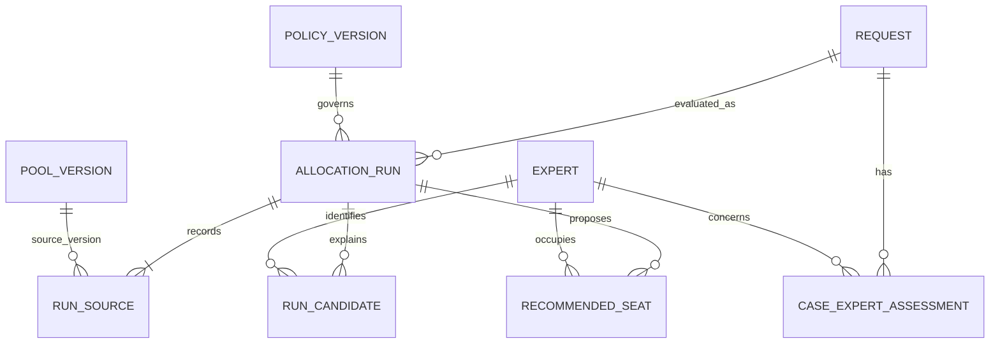

# Allocation engine — workshop and proposed implementation contract

**Current status:** user authorised proceeding with coding after approving the SRS rule mapping and simplifying the remaining questions (DEC-038–040). The recommendation engine, saved request evaluation, staff verification and isolated synthetic demonstration are implemented; see [handover and rule-to-code mapping](17-allocation-implementation.md). Real ranking remains dependent on reconciled history; formal issue/final-lock remains a later phase. The original discussion text below is historical where this status or subsequent decisions supersede it.

13 September 2026. **Discussion draft, not implementation approval.** The user authorised beginning the next workshop after the expert/pool phase. First answers confirmed in DEC-034: lifetime last locked nomination, verified never-nominated first; allocation-date-only eligibility; VC first. Answers to individual questions do not approve an unseen schema or the whole engine package. Consolidate the answers and obtain phase approval before dependent code.

Sources: all 30 numbered sections of the original SRS reread for this workshop, with its page-18 visual summary inspected; [current requirements](09-current-requirements.md), DEC-014–031 and the approved [expert/pool package](13-experts-and-approved-pools-workshop.md). The SRS remains the source of rules except where the user explicitly changed them. Sample letters remain formatting references.

## 1. Demonstration contract

An authorised processing officer opens a saved request, sees the applicable approved sources, and asks the engine for recommendations. The result explains each recommended person, each exclusion, the fairness order and whether SC/ST and OBC representation comes from the main six or additional nominees. A shortage is visible and cannot masquerade as a complete panel.

This phase proposes an explainable recommendation workbench. Formal offer approval/issue, management's final choices, final locking, count adjustments and letters remain later phases. A saved recommendation is not an outstanding issued offer and never changes utilisation. The interface must use those distinctions in ordinary Hindi/English office language.

The existing application contains request drafts, not a completed scrutiny/document workflow. Until that workflow and its mandatory inputs are approved, a recommendation from such a draft is a labelled simulation, not proof that the college request is eligible for official processing.

## 2. Settled rules — do not ask again

| Rule | Authority and implementation consequence |
|---|---|
| University staff operate the system | POC enters college information; existing shared processing queue. No college accounts. |
| Source is the full approved candidate pool | Source lists are not fixed six-person outputs. Applicable scope and approval must be established. |
| Main offer is one Principal and five Professors | One distinct person per seat. Separate VC nominee; category supplements as required. |
| Subject-expert composition provisionally matches | Independent policy per appointment type, visibly provisional for subject-expert use. A later change must not mutate other types or history. |
| One person may qualify for several roles | Principal post and Professor rank can coexist. Approved memberships remain separate; identity, permanent sequence and utilisation remain common. |
| Own-college exclusion is absolute | Compare verified institution IDs in every role and replacement. No shortage or override exception. |
| Fairness order | Lowest current July–June utilisation, oldest last nomination date, permanent sequence ascending. No category-first reshuffling to avoid supplements. |
| Date tie-breaker | Latest locked nomination across all years; verified never-nominated experts precede previously nominated experts on equal annual counts. Missing history is unknown. |
| Eligibility date | Allocation date only, as explicitly chosen by the user. Do not require list/institution/rank validity on the proposed selection date. Later event revalidation mechanics remain a separate workflow question. |
| Role precedence | VC first, then six-name main panel, excluding the VC person from other seats. Exact VC decision authority and Principal/Professor ordering remain in the concrete package. |
| Counting | One common count across roles/types, only locked final members. Final-lock date determines nomination year. Drafts and offers do not count. |
| Pending offers | Display separately; no exclusion, extra count, demotion, pending-load score or reserved-first tier merely because an offer exists. |
| Representation boundary | Check the main six for SC/ST and OBC. VC category does not satisfy that check. Add the missing category from its approved source; Assistant Professor permitted for this supplemental duty. |
| VC qualifications | Verified Professor rank; eligible external expert or internal expert of an affiliated Government/Aided college. No inferred rank equivalence. |
| Unavailable/conflicted experts | Skip with recorded reason; case conflicts do not permanently change sequence. |
| Replacement | Engine recommends next eligible person and preserves original and reason. Only a later authorised locked-final change adjusts utilisation. |
| Ordinary operator cannot choose favourites | No editing sequence or dragging ranked candidates. Future exceptional departures preserve recommendation, reason, officer and authority. |

## 3. Proposed method and modular boundaries

1. Read the request revision: institution, appointment type, subject and proposed selection date. Show incomplete facts instead of inventing them.
2. Resolve the authorised appointment-policy version and applicable approved list versions. Show their references and scope. Resolve overlapping lists using the decision below, never by whichever database row happens to appear first.
3. Build a distinct-person candidate set from memberships. Evaluate institution/rank, dates, active status, approved source, subject applicability, case availability and conflicts. Preserve multiple applicable approval references without duplicating a person.
4. Obtain a validated utilisation snapshot with its nomination year, history coverage and last-nomination facts. Unknown history prevents an authoritative ranking; demonstration history must be explicitly synthetic.
5. Apply the same fairness sorter within each role. Fill roles in the approved precedence order. Exclude people already occupying another component of this same proposal.
6. Check categories in the chosen main six and recommend any required supplements. Do not change the six merely to reduce the number of supplements.
7. Return either a complete recommendation, a provisional simulation with unresolved checks, or a blocked result with shortages/data issues. Show exclusions separately from eligible ranked alternatives.
8. Save an immutable run with evidence. Later regeneration creates a new run; viewing a previous result does not silently recalculate it.

Keep candidate retrieval, eligibility checks, fairness ordering, panel composition and explanation rendering separate. Use explicit validated policy versions and tested rule implementations, not arbitrary administrator-written scripts. The common sorter accepts facts and returns deterministic ordering; it does not read form state or write counters.

### Proposed record relationships for review

The diagram describes successful runs; a blocked run may have no sources or seats. Names are conceptual, not approved database definitions.

| Record | Proposed contents, ownership and constraints |
|---|---|
| Policy version | Appointment type, version, composition, approved behaviour identifiers, provisional/confirmed status and provenance. Publishing authority remains unresolved; no general policy editor proposed. |
| Case/expert assessment | Request and expert IDs, applicable date/range, availability, conflict outcome, reason/evidence, recorded-by/time and superseded assessment. Missing declaration is unknown, not “no conflict”. No additional inspector role. |
| Allocation run | UUID, request revision, actor/time, policy version and rule snapshot, date basis, nomination year, history provenance, result status and previous run when regenerated. Immutable once completed. |
| Run source | Exact source version and approval references used. Capture applicability facts rather than relying on subsequently changed master display. |
| Run candidate | Expert ID and necessary historical identity/rank/institution/category facts, evaluated role, relevant source memberships, assessment evidence, exclusions, count/date/sequence keys and resulting rank. Avoid copying unrelated contact data into every snapshot. |
| Recommended seat | Run, component/role, seat position, expert and reason. Unique expert per run; unique component/position. Additional-category seats exist only when required. |

No utilisation ledger schema is smuggled into this slice. A history provider returns validated facts; initially it can support isolated synthetic demonstrations. Real opening-history loading and authoritative ledger integration need their own approved design. No public form for freely editing utilisation totals.

All run records and audit commit together. Proposed runs retain the evaluated revisions of relevant inputs; before later issue or final lock, revalidate against fresh data. A changed source, assessment or utilisation snapshot requires explicit regeneration/review. Two simultaneous recommendation runs may return the same eligible people: recommendations create no reservation. Later locks must serialize utilisation updates and reject stale/repeated actions under the final-lock design.

Proposed access: existing processors generate simulations/recommendations; reviewers read non-contact results; master-data permission alone does not confer nomination powers. Official VC decisions, overrides, issue and lock powers remain unassigned until their authority workshop.

## 4. Worked examples

All names and figures below are synthetic. All candidates are eligible unless an exclusion is stated. These examples are prospective acceptance criteria, not reports of implemented engine tests.

### A. Unambiguous fairness order

| Expert | Annual count | Last locked nomination | Sequence |
|---|---:|---|---:|
| A | 2 | 2026-08-20 | 10 |
| B | 1 | 2026-09-01 | 20 |
| C | 1 | 2026-08-01 | 30 |
| D | 1 | 2026-08-01 | 25 |

Expected order: **D, C, B, A**. A's smaller sequence cannot outweigh utilisation. D beats C only on sequence. Adding a pending offer to D changes neither count nor order.

### B. Verified never-nominated versus unknown history

N has verified zero lifetime nominations. E has zero nominations this year and a nomination in March of the previous cycle. U has no loaded history. Under confirmed A-01, N precedes E. U cannot be treated as zero or placed first: the candidate set's history must be resolved before authoritative allocation. A clearly labelled synthetic demonstration may still proceed independently.

### C. Own-college exclusion and skip reasons

The highest-ranked Professor works at requesting College A. Exclude that expert, record own-college reason and consider the next eligible person. Do the same if that person is on the VC/category source. Similar Hindi/English institution names never replace ID comparison. If only four other eligible Professors remain, the run is incomplete; no self-college exception.

### D. Category outcomes after main-six selection

| Categories represented in main six | Extra nominees |
|---|---|
| SC or ST, and OBC | None |
| SC or ST only | One approved OBC expert |
| OBC only | One approved SC/ST expert |
| Neither | One SC/ST and one OBC expert |

A VC nominee belonging to SC does not remove the need for the SC/ST supplement where the main six contain neither SC nor ST. Select supplements by the same fairness keys, allowing the SRS Assistant Professor exception and preserving distinct persons.

### E. Shared-role collision exposes a missing rule

X is first on the eligible VC ranking and one of exactly five eligible Professors; Y is second on VC ranking but is not approved for the main Professor list. Choosing X for VC first leaves only four Professors. Choosing Y could fill all seats, but bypasses the first VC recommendation.

The system must not silently optimise this choice. A-03 confirms VC-first precedence. Proposed behaviour is to retain X as the recommendation, expose the shortage and show eligible alternatives; any authorised choice of Y belongs to the recorded VC-decision workflow. No automatic exception or backtracking policy is assumed. Principal/Professor dual eligibility has the same issue: propose filling Principal before the five Professors, subject to explicit phase approval.

### F. Expiry and transfer between dates — confirmed date basis

Allocation occurs on 20 September, a list ends on 30 September and selection is proposed for 5 October. Under the user's allocation-date-only choice, the future expiry does not disqualify the list from the 20 September allocation. A fresh allocation on 1 October cannot use that expired list. Use verified institution/rank facts applicable at allocation, not a silent future-date check. Unknown historical facts remain unresolved. A later discovered own-college conflict and the checks on issue/lock belong to the workflow gate; this date choice does not waive the unconditional own-college rule.

### G. Replacement and representation

An offered SC member withdraws. Preserve the original and reason; exclude the withdrawn person for that case and the people already occupying its other seats. Rank replacements for the vacated role, then recheck category representation. If the replacement is General and the remaining main six have no SC/ST, a supplement is now needed. Do not quietly choose a lower-ranked SC replacement to avoid that supplement. Persisting issued replacements and any post-lock count adjustment remain the next phase.

### H. Annual boundary and simultaneous requests

A final lock on 30 June contributes to the closing year; a lock on 1 July contributes to the new year. Existing history is preserved. The year used to rank a June recommendation for a July selection is a separate choice (A-02), not implicitly answered by the final-lock rule. Until any final lock, two requests with identical eligible candidates and facts can legitimately produce identical recommendations.

## 5. Questions requiring answers before dependent implementation

**A-06 coverage clarification (DEC-036):** the user confirms the two final-selection PDFs are examples from a larger set. They are valid partial historical evidence, not a complete opening-history dataset. Obtain and reconcile the remaining records for the agreed period before calculating authoritative opening utilisation. Lifetime last-nomination/never-nominated facts require sufficiently complete prior history or separately verified evidence; absence from these examples proves neither zero utilisation nor never nominated. Synthetic demonstrations may proceed within their approved boundary.

The first three have answers, recorded below; remaining subquestions are explicit. Recommendations elsewhere are proposals, not University rules.

| ID / related register | Question and proposed method | Dependency |
|---|---|---|
| A-01 / Q-11 | CONFIRMED: latest locked nomination across all years; verified never-nominated people first on equal annual counts. Unknown history remains unresolved. | Ranking and history input contract |
| A-02 / Q-07, Q-12 | CONFIRMED: allocation date only for institution/rank/list eligibility. Dual-date proposal rejected. Separately propose ranking with the July–June year containing allocation date, because SRS says current year. Eligibility-date answer does not settle later revalidation events, mandatory request fields or the ranking-year subquestion. | Date checks and cycle selection |
| A-03 / Q-15 | CONFIRMED: VC first, then six-name panel without duplicate person. SRS section 2/visual and sections 20/29 differ in ordering. Principal before Professors and no silent backtracking remain proposed; alternative VC choice needs recorded authority. | Composition order and shortages |
| A-04 / Q-10 | CONFIRMED (DEC-037): record the person who verifies the availability/conflict decision. Retired or transferred means permanently inactive and excluded from subsequent allocations across roles; do not merely update institution and automatically restore eligibility. No mandatory transfer-document upload. Preserve status, reason, verifier and audit history; distinguish the verifier from the staff member entering the record if different. Other status scopes and handling of unknown checks remain at the workflow gate. | Assessment schema and operational eligibility |
| A-05 / Q-13 | When a required role cannot be filled, propose showing partial recommendations and exact shortage, preventing complete/issue status, and referring it for approved data/source correction. Do not broaden rank, subject, own-college or approved-source rules. Is there any prescribed institutional procedure? | Exhausted-pool response |
| A-06 / Q-17 | PARTLY RESOLVED (DEC-035): user confirms both supplied additional PDFs record finally selected members, not merely offered panels. They are historical selection evidence as well as format references. Still establish coverage/completeness, expert identity mapping, applicable historical finalisation dates and any later cancellations/replacements before reconciled import. Do not assume absent people were never nominated or invent a historical system-lock timestamp. | Real allocation, not synthetic demonstration |
| A-07 / Q-06, Q-15 | RESOLVED: one applicable approved pool per role/type/subject. No list picker or automatic union. Replace the same list's version and retain history; overlapping active source records must be corrected rather than silently selected between. | Implemented source resolver |
| A-08 / Q-07, Q-15 | CLOSED as redundant: apply SRS 4.1 VC eligibility directly, with SRS category rules and recorded approved scope. Do not demand fresh confirmation of those rules or invent extra subject-equivalence/authority requirements. Recording a source does not grant operational VC approval. | Implemented eligibility; operational decisions later |

Later gates remain: final subset size/roles/categories, offer/override/lock authority, cancellation, cross-year replacements and resulting last-nomination history, official scrutiny/evidence workflow, letter/signing/delivery rules. They do not block a clearly limited synthetic recommendation slice once its own policy package is approved.

## 6. Proposed delivery sequence after approval

1. **First demonstration, roughly 3–4 working days:** approved policy/input contract, pure sorter and eligibility explanations, synthetic fixtures, meaningful fairness/date/own-college tests. Demonstrate ranking before adding workflow persistence.
2. **Second demonstration, roughly 3–4 working days:** distinct-person composition, category supplements, collision/shortage results, saved run snapshots and office workbench; permission and stale-data checks.
3. **Phase verification, roughly 1–2 working days:** PostgreSQL integrity and concurrency checks, browser journey, Hindi display, regression of expert/list forms, and a repeatable stakeholder script. Real-data readiness depends on A-06 and source approval evidence.

Dates are estimates after decisions and package approval. No waiting period answers an unresolved rule. Independent approved work can proceed, but provisional output must never be presented as an officially issuable panel.

## 7. Exit criteria and next approval

- Worked examples A–H have agreed outcomes, including the unresolved branches.
- Every output identifies policy, source, dates, history basis and candidate reasons; identical inputs give identical output.
- All mandatory exclusions and duplicate-person checks are tested; count/date/sequence precedence and unchanged pending-offer ordering are verified.
- Main-six/category/VC components remain distinct; shortage and missing data cannot appear as successful complete allocation.
- Saved runs preserve evidence and revisions; regeneration is explicit; no count, offer or lock side effect.
- Processor/reviewer permissions and direct URLs are tested. Hindi/English text survives save and display.
- Synthetic tests do not imply loaded real nomination history or production readiness.

After answers, revise this document into one concrete schema/behaviour/acceptance package and ask for approval of that scope. Until then, this workshop changes documentation only.
