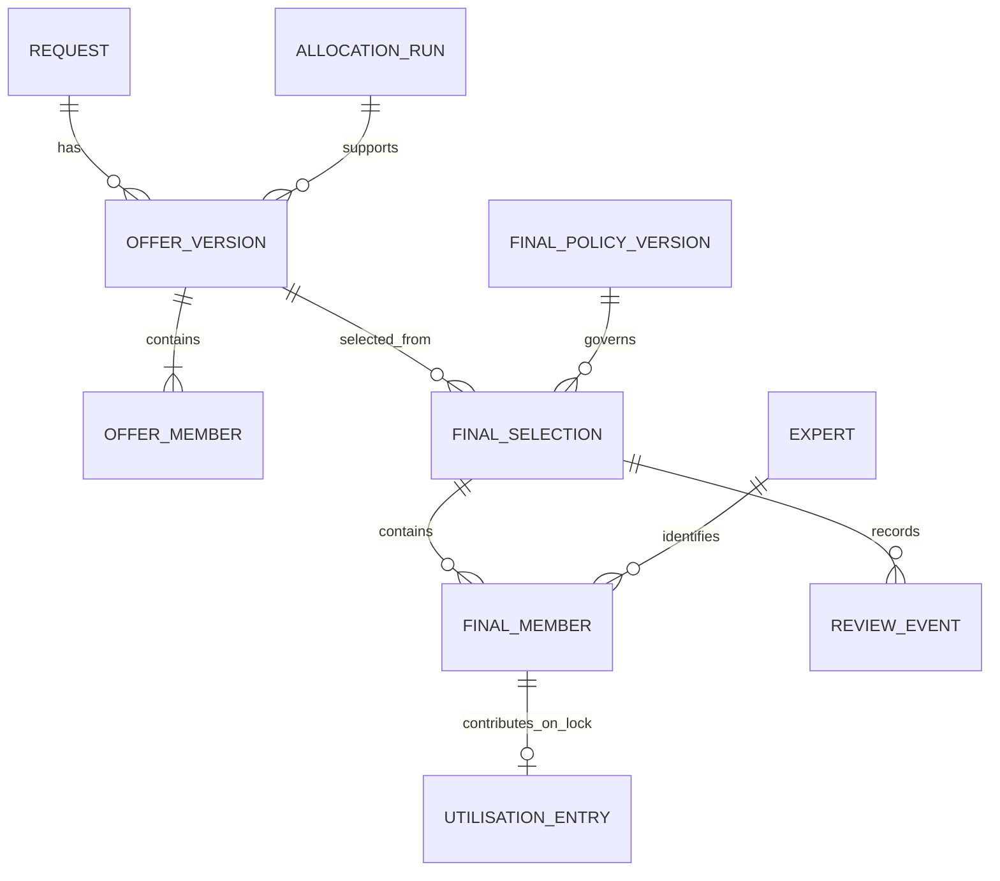

# Final selection and reviewer lock — implementation proposal

Prepared 13 September 2026. **Approved and implemented.** The user gave LGTM to this package, including the proposed VC exclusion from the final category check. The original proposal wording below preserves the reviewed boundary; see [implementation handover](19-final-selection-lock-implementation.md) for delivered behaviour and verification.

## 1. Confirmed decisions

- Management makes the final choices outside the application; the university POC records them.
- Provisionally select **one Principal + four Professors + one separate VC nominee**, plus required category members. This gives 6–8 distinct final members. The offered main panel still contains one Principal and five Professors, with VC/category components separate.
- Keep the final composition separately versioned for Principal, HoD and subject-expert appointments. Initially all three use the provisional composition above. A later VC change creates a new version, preserving prior locks.
- The **reviewer** has final-lock authority. This deliberately expands the existing read-only reviewer role; it does not grant expert-master editing or override authority.
- Block final lock until both SC/ST and OBC representation are complete. Incomplete drafts may be saved.
- Only locked final members contribute to one common utilisation count across roles/types. Final-lock date determines the July–June year. Repeated submissions must not count twice.
- Preserve source recommendation, actual choices, verification, actor/time and historical facts. Retirement/transfer remains permanently inactive; no mandatory transfer-document upload.

Sources: SRS 6, 12–18, 24–27 and 30 as mapped in document 17; user overrides on final selection, reviewer authority, categories, common counts and lock-date attribution. The latest confirmations above govern final composition instead of inferring final size from the offered-panel numbers.

## 2. Proposed staff journey

1. **Record the offered panel.** Start from a complete saved engine result. The POC records the actual communication/issue reference and date. Freeze the offered names and their role/source facts. This records a panel communicated through the existing university process; it does not generate an official letter or automatically grant approval.
2. **Record management's choices.** Show only offered people in their offered roles. The POC selects four of the five Professors, retains the offered Principal and separate VC nominee, and records applicable category members. Save the management decision date/reference and POC attribution. No arbitrary expert search for final seats.
3. **Show completeness.** Display required versus chosen seats, category coverage, duplicate/own-college/inactive/conflict issues, and missing decision/verification evidence. A draft does not change counts.
4. **Submit to reviewer.** Freeze that draft revision for review. Reviewer may return it with a reason. Further POC edits create a new revision and require fresh review; no silent edits under an approval.
5. **Reviewer locks.** Show the exact people and count consequences, run validations again and commit final membership, utilisation entries and audit together. Show reviewer and lock time afterward.
6. **Inspect history.** Users can reopen the original offer, management choices, returned revisions and locked result. No ordinary edit/unlock/delete action for a locked selection in this slice.

### Category interpretation proposed for package approval

Use the selected **Principal + four Professors**, plus any additional category members, to establish final SC/ST and OBC coverage. Keep the VC nominee separate from that category test, consistent with the current offered-panel rule. The user confirmed complete representation is mandatory, but did not separately state whether VC may satisfy it at final lock; **this exclusion is an explicit proposal, not an already confirmed answer**.

If management leaves out the only OBC/SC-ST expert, show the missing category. They can revise their choices to include the offered category expert. If an additional category person is needed, the engine recommends that person under the same approved category-source, fairness and uniqueness rules. The university must communicate an **addendum** containing that recommendation before the POC can select the new person. Preserve the original offer; no silent addition and no manual bypass.

This addendum fills a newly missing category; it is not a replacement/cancellation of an already locked member. If no eligible category expert is available, keep the selection blocked.

### VC approval evidence proposed for this slice

The VC nominee's approval remains a prerequisite, distinct from the reviewer's final lock. Propose capturing the actual VC decision reference/date and the person recording it, as an existing university decision. Recording it does not mean the POC approved on behalf of the VC. The reviewer verifies that reference before lock. A dedicated VC login/approve/reject interface and alternate-nominee overrides are separate work; the annotated PDF's suggestions were reviewed but not automatically adopted.

For now, an alternate VC choice outside the recorded offered version requires a separately authorised revised-offer workflow; this slice does not grant an override to the POC or reviewer.

## 3. Screens and permissions

| Screen/action | POC / processor | Reviewer | Account admin / directory maintainer alone |
|---|---|---|---|
| View offer, selection and history | Yes | Yes | No new access |
| Record communicated offer/reference or category addendum | Yes | View/verify | No |
| Record choices and management/VC decision references | Yes | View/verify | No |
| Submit or revise a returned selection | Yes | No direct replacement of management choices | No |
| Return with reason | No | Yes | No |
| Lock final selection | No, unless separately holding reviewer role | Yes | No |
| Edit locked members, override eligibility or cancel | Not provided | Not provided | Not provided |

Rename the existing reviewer display label from “read only” to “Reviewer”. Existing active reviewer grants would receive the newly approved lock capability; review those grants before any operational rollout. Combined processor/reviewer grants remain possible as in the current account model; this proposal does not impose an unapproved mandatory different-person rule. The recorder and locker are always shown separately, even if they are the same authorised person.

## 4. Proposed records and relationships

Draft/blocked allocation results cannot become offers. A category addendum links both its original offer and its new engine evidence. Only one final selection may be initially locked per request; offer versions and returned draft revisions must not allow a second initial lock.

| Record | Proposed fields and constraints |
|---|---|
| Final policy version | Stable key, appointment type, version, one Principal/four Professors/one VC counts, category-check boundary, provisional flag and provenance. Seeded through reviewed changes; no unrestricted policy editor. |
| Offer version | UUID, request/revision, source run, previous version if addendum, issue reference/date, recorder/time, immutable request/policy/source snapshot. A completed recommendation is not itself an issued offer. |
| Offer member | Version, expert ID, component/role, position and preserved identity/rank/category/institution facts. Distinct expert per offered version. |
| Final selection | UUID, request, offered version, final policy version/snapshot, revision, draft/submitted/returned/locked state, management decision reference/date, VC decision reference/date, recorder/time, nullable locker/time before lock. |
| Final member | Selection, offered-member reference, expert ID and selected role. Unique person per selection. Role must match offered role; no duplicated person counting as Principal and Professor. |
| Review event | Selection/revision, submit/return/lock event, actor/time and reason. Append-only; returns require a reason. |
| Utilisation entry | UUID, locked selection/member, expert ID, role, appointment type, request/college/subject snapshot, lock timestamp, July–June year and contribution +1. Exactly one entry per locked member. No user-editable totals or deletion endpoint. |

Reuse current staff, directory, expert, allocation and audit tables. Additive migrations must preserve existing records. Protect referenced identities from deletion. Freeze locked business fields and dependent membership/ledger rows with database guards, rather than relying solely on hidden edit buttons.

Field lengths proposed: references 500 characters, review reasons 1000; dates stored separately from timestamps. Names remain Unicode. Evidence references are required at submission; draft entry can remain incomplete. This slice captures references and verification, not document uploads or digital signatures.

## 5. Final-lock validation and counting

Before lock, check:

1. Current reviewer authority, submitted selection revision and absence of an existing initial lock for the request.
2. Exact provisional final-role counts, distinct identities, and membership in the recorded offer/addendum.
3. Both required categories under the approved final-category boundary.
4. VC decision reference and recorded availability/conflict verification for every final member. Unknown is not clear; any changed request/selection facts require renewed review of the relevant verification.
5. Current hard exclusions: no own-college member, permanently inactive member or recorded case conflict. Verify preserved source/eligibility evidence against the original allocation-date basis. Do not silently replace the user's allocation-date-only validity rule with a selection-date or lock-date expiry rule.
6. Offer, request and selected revisions agree with the reviewer-visible evidence. A material change invalidates submission and requires explicit regeneration or corrected evidence. Updated utilisation alone does not silently rewrite an already communicated offer; subsequent allocations use the new totals.

Acquire the existing access-control mutex and appropriate request/selection/expert locks in a consistent order; recheck permissions after locking. Persist the lock, all contributions and audit in one transaction. Duplicate retries return the existing lock result; competing different versions cannot both succeed. Notification failure must not roll back or repeat a successful lock; notifications are outside this slice.

Use server lock time in the university timezone. The POC's management-decision date is recorded for history but cannot backdate the system's annual counting event. Lock on 30 June contributes to the closing year; lock on 1 July contributes to the new year. Preserve previous years.

The history provider reads reconciled opening history plus committed utilisation entries. Derive common annual/lifetime totals and latest locked nomination; exclude unlocked drafts and unselected offered members. **Without verified opening-history coverage, newly recorded events are only known events, not proof of complete totals or never-nominated status.**

## 6. Historical-data and demonstration boundary

The full university history has not been supplied. Existing real allocations therefore cannot produce complete rank-authoritative offers yet. Do not bypass this by treating the two sample PDFs as complete history, allowing arbitrary manually entered offered names, or setting missing counts to zero.

Propose a separate, clearly labelled synthetic demonstration database with complete fictional opening history. Run the entire journey there: request, engine offer, management choices, reviewer return/lock and updated subsequent ranking. Synthetic contributions must never enter real expert records or real reports. The current database retains real-data drafting/checks until history reconciliation and offer prerequisites are available. Database separation is a demo mechanism, not a second production deployment.

Opening-history import and mapping of pre-system finalisation dates remain a separately reviewed operation when the data arrives. Do not invent historical lock timestamps or a fresh-start policy.

## 7. Worked acceptance examples

| Scenario | Required result |
|---|---|
| Offer contains P + A/B/C/D/E and VC; choose P + A/B/C/D + VC with SC/ST and OBC included | Reviewer locks six distinct people; each receives one contribution; E receives none. |
| Required category absent from final choices | Draft saves; submission/lock blocked with specific missing category. |
| VC is SC but selected main five lack SC/ST | Under the proposed non-VC final-category boundary, require a category addendum or revised main choices. This example is part of package approval. |
| New SC/ST supplement is Assistant Professor with approved eligibility | May fill the additional role, never a main Professor seat; distinct from all selected people. |
| Only three or all five offered Professors selected | Incomplete/incorrect final size; block lock, do not change the offered composition. |
| Reviewer returns a selection, POC edits it | Earlier revision/reason survives; resubmit; old approval attempt rejected. |
| Processor tries a direct lock request | Denied without reviewer authority. Admin/master alone also denied. |
| Reviewer permission revoked while screen is open | Final write rejects after checking current permission. |
| Same lock submitted twice or two reviewers click together | Exactly one locked selection and one contribution per final person. |
| Audit or ledger write fails | Entire lock rolls back; no partial membership/count change. |
| Expert retires or own-college/conflict is discovered before lock | Block; preserve evidence; no quiet manual replacement or sequence change. |
| Final policy later changes from four selected Professors | New policy version affects new selections; previously locked four-Professor selections retain their policy and facts. |
| Lock across 30 June/1 July | Count in year determined by actual lock; old history retained. |
| Opening history incomplete | Do not label partial totals authoritative or missing experts never nominated. |

Test pure composition/category checks, PostgreSQL transaction/uniqueness/immutability and concurrent lock behaviour, role/direct-URL restrictions, and the browser path from POC draft through reviewer return and lock. Re-run affected foundation/allocation tests and verify Hindi desktop/mobile screens.

## 8. Delivery scope and approval

Estimated 4–6 working days after approval and available inputs: schema/services and lock tests, POC/reviewer screens, then complete synthetic walkthrough and regression checks.

**Approval requested for this concrete package:** versioned provisional final composition, offered-version/reference capture, final choices, category addendum when required, reviewer submit/return/lock, append-only contributions and isolated synthetic end-to-end demonstration. The final-category test excludes VC as explicitly proposed in section 2; approve or amend that point with the package.

Not included: post-lock replacement/cancellation/unlock, cross-year reversals, general manual override, dedicated VC account workflow, official PDF issuance/signing, notification delivery, bulk historical import or production launch. Those do not prevent implementing the first lock correctly, but an existing locked case must not be changed through an unapproved workaround.
