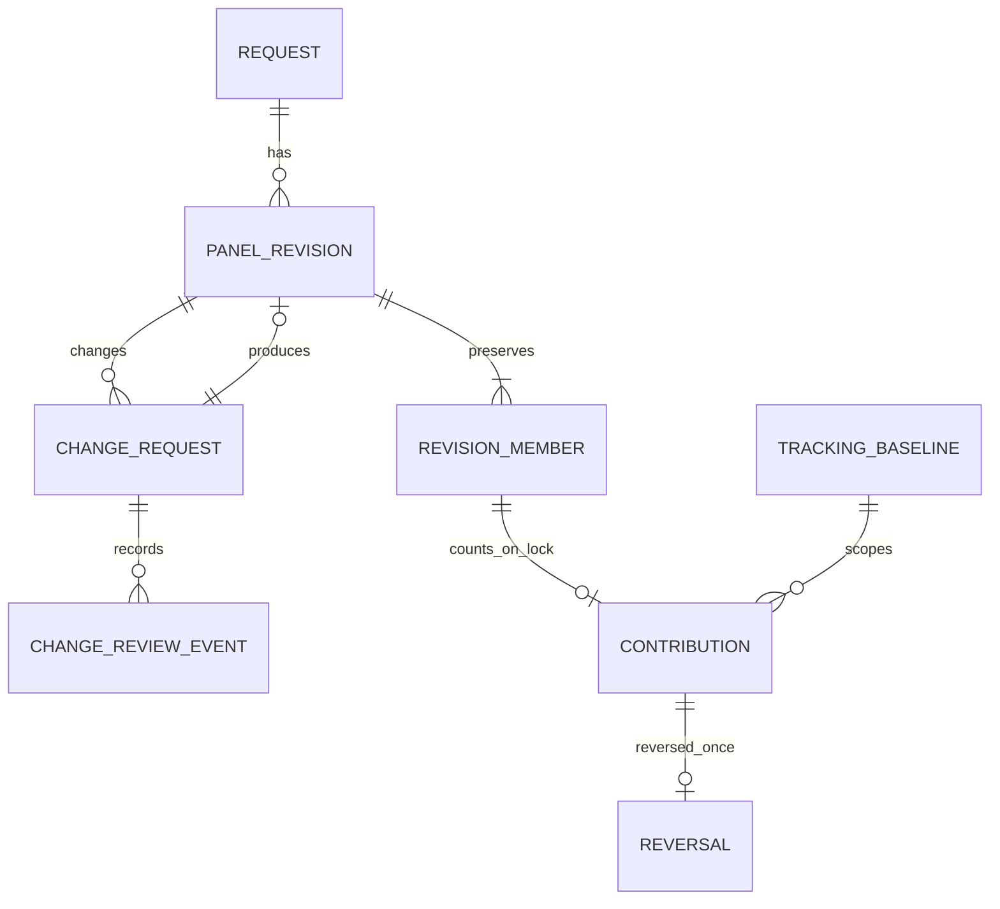

# Panel changes and fresh-start history — workshop

Prepared 14 September 2026. **Proposed; awaiting package approval.** DEC-042 already approves the fresh-start policy, but the schema and unresolved change policies below are proposals. This document does not authorise code by itself.

## 1. Confirmed boundary

- University POC records decisions; management selects the final people. The reviewer currently has initial final-lock authority.
- Offered replacements require a reason and a rule-engine recommendation. They do not affect utilisation.
- A locked replacement reduces the removed expert's utilisation and increases the replacement's only when the change is locked. Preserve the original history.
- Common counts, July–June years, permanent sequence, own-college exclusion and the existing SRS eligibility/representation rules continue to apply.
- Current final composition is one Principal, four Professors, separate VC and any required category supplements. VC does not satisfy final category coverage.
- DEC-042 permits zero starting utilisation from an agreed go-live date. The sample PDFs are reference material, not selective opening counts.

## 2. Proposed staff journey

1. POC opens the recorded panel/selection and chooses replace, add a required category member, or cancel the whole selection. Require a reason and record the verifier; document upload is not mandatory.
2. For a replacement, identify the outgoing seat. The engine recommends the next eligible person for that role, excluding other retained members and the person being replaced. Preserve rankings, skipped candidates and reasons. A shortage blocks completion without relaxing the rules.
3. Use the date of this replacement allocation for its eligibility and ranking inputs. Preserve the original allocation's date and facts. This extends the allocation-date-only rule to the new allocation; it requires package approval.
4. Retain unaffected seats. Validate distinct people, own-college exclusion and full category representation on the resulting composition. If an additional category seat is needed, recommend it explicitly; do not silently reshuffle the committee.
5. POC records revised communication and management decision references as applicable; a changed VC nominee requires a fresh VC decision reference. Submission freezes the proposed revision.
6. Reviewer returns it with a reason or confirms it. For an unlocked offer this confirms a new offered version, with no count change. For a locked selection it locks a new effective committee revision and its accounting changes together.
7. Show both the original and current committee, why it changed, who recorded/verified/approved it, and the count effects. Pending changes are visible but do not quietly alter effective membership.

Propose the existing processor/reviewer permissions for these actions. Account administration alone gains no authority. A proposed cancellation changes nothing until reviewer confirmation; confirmation cancels the effective selection and reverses its remaining active contributions. A cancelled selection cannot be silently reopened. Cases where members have already performed the selection work should remain blocked from this cancellation path until the university confirms their accounting policy.

## 3. Proposed accounting, including the year boundary

Keep original contributions immutable. Add one linked reversal for each removed contribution; do not decrement editable counters or erase history. A replacement receives a new contribution in the year of its own change lock. The reversal belongs to the original contribution's year, with the actual reversal timestamp preserved separately.

| Example | Proposed outcome |
|---|---|
| Offered A is replaced by B before final lock | No utilisation change for either person. |
| A locked in September; B replaces A in October of the same year | A's original contribution is reversed; B receives one contribution in that same nomination year. |
| A locked on 30 June; B replaces A on 2 July | Reverse A in the closing year; count B in the new year. Do not subtract from A's new-year total. |
| Reviewer confirms the same replacement twice | Exactly one reversal and one replacement contribution. |
| A replaced by B, later B by C | Reverse each removed active contribution once. C is the current contributor. Original events remain visible. |
| Whole unperformed selection is cancelled | Reverse the current active contributions, including replacements, each in its original year. |

Propose deriving the last-nomination tie-break from contributions that have not been reversed. If A's newest contribution is reversed, fall back to A's previous surviving nomination; if none survives, display “no nomination recorded since go-live”. This is a counting interpretation for approval, not an assertion that the SRS specifies every reversal detail.

## 4. Proposed records and ownership

| Record | Proposed facts and constraints |
|---|---|
| Tracking baseline | Stable identifier, operational start date, approval reference, activated by/time. No operational allocation before activation; no invented historical coverage. Freeze once operational activity exists. |
| Panel revision | Request, previous revision, source allocation evidence, offered/final stage, policy snapshot, communication reference/date, actor/time. Preserve original immutable selection and allocation records. One current effective revision per request/stage. |
| Revision member | Revision, expert, role/seat, preserved facts, source recommendation and predecessor member where applicable. Unique identity and seat within a revision. |
| Change request | Target revision, replace/category addition/cancel type, reason, outgoing seat, draft/submitted/returned/confirmed state, revision number, verifier, management/VC references, recorder and timestamps. |
| Change review event | Change request/revision, action, actor/time and required return reason. Append-only. |
| Contribution | Existing locked entries retained; new revision-linked contributions carry expert, role, lock timestamp, nomination year and tracking baseline. One per locked new member. Retained members do not receive another contribution. |
| Reversal | Original contribution, confirmed change, reason, actual timestamp, actor and original nomination year. Unique original contribution, preventing repeated subtraction. |

Implementation will require additive migrations adapting the current FinalSelection/FinalMember/UtilisationEntry design. Existing records and database immutability guards must remain protected. A migration must not label existing demo records operational, invent a go-live date, or rewrite historical locks. Detailed field mapping must be included in implementation review before migrations are applied.

## 5. Fresh-start history integration

Implement DEC-042 by deriving common annual totals and latest surviving lock from operational contributions within the activated tracking baseline. Experts without such events have known zero *within that scope*. Initial tied candidates use permanent sequence. Keep the approved July–June rollover; do not reset lifetime tracked tie-break history each July.

The current history provider returns unknown history. Replace that boundary only with an explicit activated baseline and committed operational ledger; do not globally interpret missing records as zero. Demonstrations use a separate synthetic baseline/environment and must not affect operational ranking. Exact go-live date stays pending until launch. Date entry/activation authority proposed: a controlled deployment operation authorised by the project owner, not an unrestricted staff setting.

## 6. Integrity and acceptance

- Lock the target current revision and affected accounting records in a consistent order. Recheck reviewer permission and source revision after locking; competing changes cannot both confirm against the same old revision.
- Recheck active status, own-college, recorded conflicts and required verification before confirmation. Retired/transferred remain permanently inactive. Preserve the new replacement allocation's date basis rather than substituting selection-date eligibility.
- Commit effective revision, reversal/contribution entries and audit together. Failure rolls back all effects; retries return the existing result.
- Verify pre-lock replacement has no count effect; same/cross-year replacement and chained replacement reconcile exactly; whole cancellation cannot reverse twice.
- Verify unknown verifier/shortage/missing category blocks confirmation; VC remains outside category coverage; no arbitrary off-engine replacement.
- Verify retained members are never counted again, old snapshots stay unchanged after master edits, and stale submissions fail visibly.
- Verify fresh-start ranking begins at sequence, changes after locks, handles reversals and annual rollover, and excludes demo events.
- Demonstrate POC proposal, reviewer return, corrected submission, confirmed replacement and before/after history in the browser. No official letter generation or notification is claimed by this slice.

## 7. Delivery order and decisions needed

1. Finalise this workshop's policies and concrete migration mapping for approval.
2. Implement fresh-start baseline/history integration and meaningful accounting tests.
3. Implement versioned offered changes/category addenda and their staff/reviewer journey.
4. Implement locked replacements and agreed cancellation, including transactional checks and a repeatable demonstration.

Decisions requested: reviewer authority for these changes; original-year reversal/new-lock-year replacement accounting; surviving-contribution last-nomination semantics; replacement-allocation-date eligibility; cancellation limited to cases where selection work has not occurred. These proposals are not silently adopted. PDF issuance, signing, notifications and completed-work cancellation policy remain outside this package.
