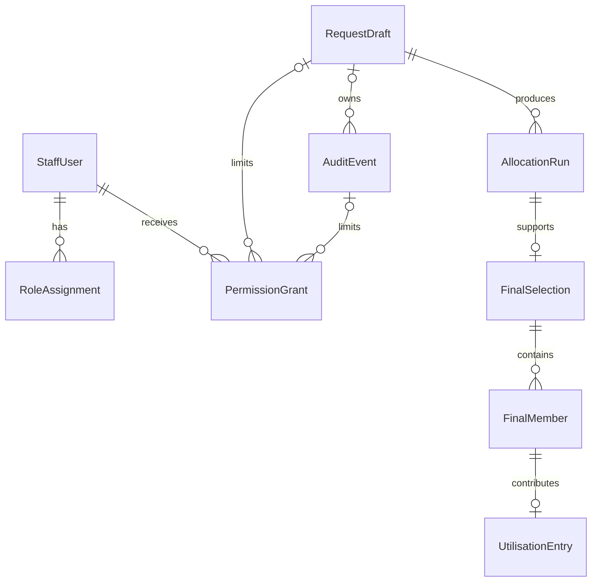

# Permissions and VC decision workflow workshop

Prepared 20 September 2026. Status: implemented, with the workflow correction below applied on 22 September 2026.
The role responsibilities and responsibility details below are approved conversation decisions. Obsolete demonstration workflow data and the separate EC-list subsystem were cleared from the local database on 20 September 2026 after a recoverable local backup; staff accounts and master records were retained.

## 22 September 2026 workflow correction

For a newly submitted request, the Registrar/Reviewer only scrutinises the request and either returns it or accepts it as valid for VC action. The VC alone generates, views and verifies the proposed panel after that acceptance. Admin retains its agreed global override. This correction supersedes every earlier statement in this document that lets a Registrar generate, view or verify a proposed panel.

## 1. Approved behaviour

- University POC enters requests for all colleges. No college login.
- Registrar is the Reviewer: scrutiny and administrative verification only. A valid request is accepted for VC action.
- VC generates the panel after Registrar acceptance, approves the VC nominee and chooses the final panel.
- VC approval locks the final selection, records the decision and updates utilisation atomically. Admin may perform the same action. Registrar no longer has this power by default.
- Proposed names are visible only to VC and Admin by default. POC and Registrar see status until finalisation; POC then sees the final selected names and issued final letter.
- VC sees each proposed member's current-year count, lifetime count and last nomination date.
- Admin has all operational permissions and can grant additional access to others. Audit access is absent by default for everyone else.
- The EC-approved expert directory is the approved candidate source. No separate EC login or approval workflow.
- Offered composition stays one VC, one Principal, five Professors, plus required category supplements. Final composition stays one Principal and four Professors, separate VC and required representation.
- Fairness remains annual count, last nomination date, permanent sequence. This phase does not add subject preference ahead of any of those criteria.

## 2. Default permission matrix

| Capability | POC | Registrar | VC | Admin |
|---|---|---|---|---|
| View request information/status | Yes | Yes | Yes | Yes |
| Create/edit drafts and resubmit corrections | Yes | No | No | Yes |
| Accept valid request for VC action / return request | No | Yes | No | Yes |
| Generate proposed panel after accepted review | No | No | Yes | Yes |
| View proposed names and panel details | No | No | Yes | Yes |
| Record case-specific availability/conflict evidence | No | No | Yes | Yes |
| View nomination figures supporting proposed panel | No | No | Yes | Yes |
| Save final choices / approve nominee / approve and lock | No | No | Yes | Yes |
| View locked final selected names | Yes | Yes | Yes | Yes |
| Download issued final letter | Yes | Yes | Yes | Yes |
| Maintain master data | Explicit maintenance permission | Explicit maintenance permission | Explicit maintenance permission | Yes |
| View audit | Explicit scoped grant | Explicit scoped grant | Explicit scoped grant | Yes |
| Manage accounts and grant/revoke permissions | No | No | No | Yes |

VC records proposed-member verification. POC and Registrar do not receive proposed-panel identities.

Role defaults are additive. An Admin's explicit task grant can extend a user's capabilities; the UI must show the resulting access before saving the grant. Audit-only access does not confer approval/edit powers. If Admin explicitly grants access to a proposal-related audit event, it can reveal names in that event; warn about this in the grant preview rather than silently widening ordinary panel access.

## 3. Concrete permissions design

Keep the existing StaffUser and historical RoleAssignment records. Keep stored keys `processor`, `reviewer`, `admin`; correct their displayed names to POC, Registrar/Reviewer and System Administrator. Add `vc`. Keep `master` as a compatibility maintenance role for existing assignments, presented as directory maintenance rather than a university authority.

Define a controlled permission catalogue in code, for example:

`request.view`, `request.edit`, `request.submit`, `request.scrutinise`, `panel.generate`, `panel.view_proposed`, `panel.verify`, `selection.decide`, `selection.approve_lock`, `selection.view_final`, `directory.maintain`, `letter.prepare`, `letter.issue`, `letter.download_final`, `audit.view`, `audit.export`, `accounts.manage`.

Role defaults map to capabilities in one module. Avoid spreading role-name checks throughout business services. A central policy must expose both `can(user, capability, resource)` and query filtering for visible resources. Admin receives all capabilities but still follows valid business transitions, composition rules and immutable-history protections.

### New PermissionGrant record (proposed)

| Field | Meaning / constraint |
|---|---|
| id | UUID |
| user | Required StaffUser FK, protected deletion |
| capability | Validated catalogue key |
| scope | `global`, `request`, or `audit_event` |
| request | Protected nullable RequestDraft FK; required only for request scope |
| audit_event | Protected nullable AuditEvent FK; required only for audit_event scope |
| granted_by / granted_at / reason | Named Admin and required reason |
| revoked_by / revoked_at / revoked_reason | Retain withdrawn grants as history |

Database checks enforce exactly the target required by scope, complete revocation metadata and one active grant per user/capability/scope/target, using separate conditional uniqueness constraints for nullable targets. Catalogue validation limits audit-event scope to audit access and request scope to request-related actions. Account administration and directory maintenance are global permissions.

Example: grant VC `audit.view` for request R-123. VC can inspect that request's audit records, not unrelated account-change events or another request's history. Revocation removes access on subsequent requests, including bookmarked URLs. Export requires a separate export grant plus view access to every included record.

No expiry, deny overrides or user-defined permission rules in this phase. Admin revokes explicit grants or changes role assignments. Inactive accounts have no access.

### Audit event ownership (proposed additive change)

Add nullable protected `request` FK to AuditEvent. Continue storing its existing target identity and immutable payload. New request, allocation, selection, verification, letter and panel-change actions set this owner explicitly. Account and master-data events remain global.

Backfill request ownership only where an existing target resolves unambiguously. Do not guess scope from free text or names. Unresolved historical events remain Admin-only unless an individual event grant is supplied. Historical payloads and actors remain unchanged. Inspect existing database audit protection before writing this migration so an authorised backfill does not weaken runtime immutability.

Future college access will supply a college-restricted request queryset through this same policy layer. No college role, tenant table or portal is added now. Request audit access must never expose cross-college data through a shared expert's global record.

## 4. VC decision and locking

1. POC submits the request; Registrar can review/return it. Registrar or VC may generate from a submitted request, as approved; VC generation is not dependent on a new mandatory Registrar sign-off.
2. A complete proposal opens in the restricted panel workspace. VC or Admin starts final selection and saves choices. Registrar can view but cannot decide by default.
3. VC selects the final composition and confirms the VC nominee. Add one explicit `Approve and lock` action; no requirement for VC to submit a decision to themselves as Reviewer.
4. Under a transaction, recheck current authority, request/selection revisions, applicable eligibility, availability/conflicts, composition and representation. Lock the request and relevant selection rows to prevent two allocation runs for the same request becoming competing active final panels.
5. Record the actor, chosen members, nominee approval, approval time, decision evidence and utilisation entries together. Repeated clicks cannot increment counts twice. Concurrent approval of another final panel for this request must fail clearly.
6. POC now sees only selected final members. Unselected offered candidates, candidate evidence, source-run links and detailed review history remain restricted.

Use FinalSelection and FinalMember for the VC decision. `locked_by` and `locked_at` record the actual VC/Admin actor, and the general immutable audit record captures the action. The cleared local workflow has no legacy management-recorded selections. An optional VC reference can be recorded; direct authenticated approval supplies the essential actor/time evidence and does not require a fictitious external approval number.

The cleared local demonstration records do not need a legacy transition. The new VC workflow will replace the previous self-review states rather than preserve parallel paths.

The SRS allows the VC to choose a different eligible VC nominee with recorded reason. Provide this only in the VC/Admin nominee-decision flow, not a general candidate list. Replacing that nominee requires recalculating downstream seats to prevent duplication and recording a new proposal version; never edit a saved allocation snapshot. Final Professor selection remains from the offered names. If selecting four removes required representation, approval stays blocked and a rule-engine category supplement must be obtained and recorded.

## 5. Counts shown to VC

For each proposed person show name, role, institution, category, common July-June count, lifetime count and last nomination date. Label fresh-start figures as system-tracked history, not proof that the expert has never served before.

Keep generation-time figures in the immutable proposal. Show current figures separately if another final lock/replacement changed them; do not silently rerank or replace names in the saved proposal. At approval, detect stale displayed counts and return updated figures for the VC to review before committing.

Use one calculation path for displayed counts, engine ordering and reports. Reversals, nomination-year boundaries and fresh-start filtering are applied to both original and replacement contributions. Lifetime totals are derived, never manually edited.

## 6. Visibility and related workflows

Protect endpoints and returned data, not only buttons: saved allocation pages, final-draft pages, offer-letter preview/PDF, embedded member lists, assessment screens, exports and direct private-file downloads. The POC's final view receives only selected members of a locked selection and released final letters. It must not receive hidden proposal data in HTML, form options or response payloads.

Separate operational status history (submitted, returned with correction instructions, finalised) from detailed audit. Existing detail pages currently embed audit/review histories; remove these by default and place them behind scoped audit permissions.

Proposed letter responsibility: Registrar prepares/issues letters against the authorised decision; VC/Admin can also do so. POC downloads the issued final letter after lock. Draft and offered-panel letters remain restricted even after finalisation because they may reveal unselected names. Letter approval never adds utilisation or changes the approved membership.

Proposed replacement/cancellation responsibility: Registrar prepares a change; VC/Admin approves it. POC sees the approved revised final outcome, not proposed replacements. Preserve original nominations and transactional reversals. This explicitly replaces Reviewer-only confirmation in the current code.

## 7. Migration and implementation order

1. Inventory current roles, grants, unlocked selections and audit guards. Back up local database before migrations. Preserve named accounts; never infer who is VC from a person's name.
2. Add the VC role, grant schema, audit ownership and decision-workflow version; correct role labels. Preserve existing role-assignment history. Admin chooses the named VC account.
3. Implement central capability and scope checks. Update services, views, templates and file routes together. Admin inherits operations; old MASTER assignments retain directory maintenance; Registrar loses default final-lock authority.
4. Deliver restricted proposed-panel and POC final-only views, including workspaces and direct-link protection. No interim release that merely hides navigation.
5. Deliver VC nomination/selection/atomic lock, count display and concurrency protection; integrate letters and changes.
6. Deliver Admin audit browsing and scoped access grants; migrate safely resolvable audit ownership. Update decision log, current requirements and walkthrough documentation, marking superseded decisions explicitly.

Suggested stakeholder checkpoints: access/workspace demo; VC-to-final-panel demo; audit-grant/revocation demo. Then resume remaining SRS reports, operational dashboards, deployment/security/restore work and controlled pilot. E-sign stays deferred.

## 8. Acceptance walkthrough (no new test files)

- POC can submit and track a case but cannot open proposed names through any page, direct URL, letter, audit section or export. After lock, POC sees only selected final names and an issued final letter.
- Registrar scrutinises and generates; VC also generates for submitted cases. Registrar cannot save final choices or lock without an explicit additional grant.
- VC sees accurate generation-time/current utilisation, selects the approved final structure and approves once. Incomplete representation or conflicts block approval.
- Repeated/concurrent lock submissions do not duplicate counts or produce two active final panels for one request. Failures leave no partial approval or ledger entries.
- Admin can perform all operational actions with their own identity recorded. Admin cannot rewrite immutable audit history.
- A request-specific or event-specific audit grant exposes only that scope. Revocation and account deactivation stop further access. Viewing audit does not grant operational approval.
- Historical locks, letters, actors and earlier snapshots survive migration. Ordinary role changes do not automatically grant VC authority.
- Count displays agree with the effective ledger after replacement, cancellation and July rollover; old demonstration history is not silently imported or deleted.

Use configuration checks and a controlled manual walkthrough without adding automated tests, per the user's instruction. Document what was actually verified; do not call this workshop evidence that implementation passes.

## 9. Approval requested

Approve this concrete schema and method, including the proposed responsibility details for availability verification, letters and post-lock changes. The university role decisions in section 1 are already settled and do not need re-confirmation.
